# 7. Fair-pair comparison of quarantine strategies

- [Purpose of this document and where it goes in the
  paper](#purpose-of-this-document-and-where-it-goes-in-the-paper)
- [Model assumptions and criteria](#model-assumptions-and-criteria)
- [Model behaviour in the
  simulations](#model-behaviour-in-the-simulations)
- [What is the same in a fair pair, and what is
  not](#what-is-the-same-in-a-fair-pair-and-what-is-not)
- [Is the comparison really fair?](#is-the-comparison-really-fair)
- [How to read the tables](#how-to-read-the-tables)
- [Results by school](#results-by-school)
- [Summary across schools](#summary-across-schools)
- [Inside the outbreaks: where do infections come
  from?](#inside-the-outbreaks-where-do-infections-come-from)
- [Grade-to-grade spread (21/21/21 vs
  21/0/0)](#grade-to-grade-spread-212121-vs-2100)
- [One fair example per school](#one-fair-example-per-school)
- [Notes](#notes)

## Purpose of this document and where it goes in the paper

**Question.** For a measles introduction into a school, how much does
each tiered quarantine strategy (days of quarantine for high / medium /
low-risk contacts) change the size of the outbreak, and **why**?

**Why fair pairs.** With an ordinary simulation, two strategies run on
the same seed share the same outbreak only until the first case is
detected; after that each student’s disease course and contacts are
re-drawn, so part of the difference between strategies is chance. Here
every strategy is run on the **same 2000 outbreaks** with the **same
dice for every student**, so every difference in this document is caused
only by the quarantine rules (and, across tables, by vaccination
coverage and the school’s contact pattern).

**What this document provides, and where each part fits in a paper:**

| Part of this document                             | What it shows                                                                                                                               | Where in the paper                                                                                      |
|---------------------------------------------------|---------------------------------------------------------------------------------------------------------------------------------------------|---------------------------------------------------------------------------------------------------------|
| Model assumptions and criteria                    | states, parameters, quarantine rules, definitions                                                                                           | **Methods** (model description) + a supplementary table                                                 |
| Model behaviour in the simulations                | how long students stay latent / contagious / at home                                                                                        | **Methods** or **Supplement** (shows the rules in action, e.g. that a 0-day quarantine = 1 day at home) |
| Is the comparison fair?                           | 100% of students have the same disease course under every strategy                                                                          | **Methods** (one sentence + the number)                                                                 |
| Tables A and B (by school)                        | outbreak probabilities, paired differences with 95% CI, run-by-run comparison, cost in healthy days at home                                 | **Results** (main tables)                                                                               |
| Summary across schools                            | average change in cases vs 21/21/21, how often 21/21/21 did better / same / worse                                                           | **Results** (main figure + table)                                                                       |
| Where do infections come from? (Table 1)          | infections before detection, from students never sent home, from students sent home only briefly, from students back from a real quarantine | **Results** (mechanism) and **Discussion**                                                              |
| What happened to each infected student? (Table 2) | how often quarantine contained an infected student, and how many others the rest infected                                                   | **Results / Discussion**                                                                                |
| Why do strategies differ?                         | change vs 21/21/21 split by where the infections came from                                                                                  | **Discussion** (explains the result)                                                                    |
| Grade-to-grade spread and example outbreaks       | how infections move between grades; one fair example per school                                                                             | **Supplement** (illustrations)                                                                          |

> **Note**
>
> Needs the modified (“common random numbers”) measles package installed
> in its own library (default `~/R_libs_crn`, change with the
> `MEASLES_LIB` environment variable). Simulations are cached in
> `results/crn_*.csv`; delete them to re-run. Quick test:
> `N_PAIRS=200 N_DETAIL=200 quarto render 07_fair_pairs_tables.qmd`.

## Model assumptions and criteria

This section lists everything the model assumes, so the results can be
read against it. Values are read from the model itself.

### Disease states

| State                                        | Meaning                                                                  | Contagious?                                                           | At school? |
|----------------------------------------------|--------------------------------------------------------------------------|-----------------------------------------------------------------------|------------|
| Susceptible                                  | not infected (unvaccinated, or vaccinated with vaccine failure possible) | no                                                                    | yes        |
| Latent                                       | infected, not yet contagious                                             | no                                                                    | yes        |
| Prodromal                                    | contagious, no rash yet                                                  | **yes (the only contagious state)**                                   | yes        |
| Rash                                         | rash has appeared, not yet noticed                                       | no                                                                    | yes        |
| Isolated / Isolated recovered                | rash noticed: kept home for the isolation period                         | no                                                                    | no         |
| Hospitalized                                 | in hospital                                                              | no                                                                    | no         |
| Recovered                                    | immune                                                                   | no                                                                    | yes        |
| Quarantined susceptible / latent / prodromal | sent home as a contact; same disease progression as at school            | latent/prodromal continue at home, but cannot infect anyone at school | no         |

### Parameters

| Parameter                    | How the model uses it                                                                          | Value |
|:-----------------------------|:-----------------------------------------------------------------------------------------------|------:|
| Incubation period            | mean days latent; each day a latent student becomes contagious with probability 1/value        |    12 |
| Prodromal period             | mean days contagious; each day a contagious student develops the rash with probability 1/value |     4 |
| Rash period                  | each day with a rash: recovers with probability 1/value                                        |     3 |
| Days undetected              | each day with a rash: the rash is noticed (detection) with probability 1/value                 |     2 |
| Isolation period             | days kept home after the rash appears, once detected                                           |     4 |
| Hospitalization rate         | each day with a rash: hospitalized with this probability (competes with recovery)              |   0.2 |
| Hospitalization period       | mean days in hospital                                                                          |     7 |
| Vax efficacy                 | a vaccinated student’s chance of infection is reduced by this proportion (per contact)         |  0.97 |
| Contact tracing days window  | contacts in this many days before the rash count as traced (medium-risk) contacts              |     7 |
| Contact tracing success rate | share of contacts that are traced                                                              |     1 |
| Detection rate quarantine    | chance a student who develops a rash while in quarantine is detected                           |     0 |
| Quarantine willingness       | share of students who comply with quarantine                                                   |     1 |
| Isolation willingness        | share of students who comply with isolation                                                    |     1 |

Disease and intervention parameters used in every run.

| School     | Grades | Students | Transmission rate (per contact) | Days simulated |
|:-----------|-------:|---------:|--------------------------------:|---------------:|
| Elementary |      6 |      156 |                          0.0886 |            100 |
| Middle     |      4 |      236 |                          0.0455 |            100 |
| High       |      4 |      232 |                          0.0741 |            100 |

School settings.

### Rules for contacts, detection and quarantine

1.  **Contacts.** Each day, each student at school has contacts with
    students of every grade at the rate given by the school’s contact
    matrix. The chance of meeting a particular contagious student is
    that rate divided by the number of students of that grade **who are
    at school** (capped at 1). An infected contact passes measles with
    the transmission rate (reduced by the vaccine for vaccinated
    students). Students at home have no contacts.
2.  **Only the prodromal stage is contagious.** Once the rash appears
    the student is no longer contagious.
3.  **Detection.** Each day a student has a rash, it is noticed with
    probability 1/*days undetected*. The day it is noticed is a
    **detection**.
4.  **Who is sent home.** At the **end of each detection day**, every
    **unvaccinated** student who is not already at home is sent home,
    with a quarantine length set by their risk tier:
    - **high risk**: every unvaccinated student in the **same grade** as
      the detected case;
    - **medium risk**: unvaccinated students in other grades who had
      **contact with the detected case** in the 7 days before its rash;
    - **low risk**: every other unvaccinated student.

    Vaccinated students are **never** quarantined.
5.  **How long.** A student is released when *days since being sent home
    e quarantine days for their tier*. The check happens at the next
    day’s update, so **N days of quarantine = N days at home, and 0 days
    = 1 day at home** (the day after detection). In other words, “0” is
    not “no quarantine”: every unvaccinated student misses one school
    day per detection.
6.  **No extension.** A student who is already at home when another case
    is detected keeps their original release day.
7.  **Disease continues at home.** A quarantined student who is infected
    keeps progressing (latent ’ contagious ’ rash) at home; they return on
    their release day in whatever state they are in (possibly still
    latent or already contagious). A student whose rash appears at home
    is isolated.
8.  **Stage durations are geometric**: each day the same chance of
    moving on (e.g. 1/12 per day to leave the latent stage), so
    durations vary widely (see the next section and document 6).

### Outcomes and definitions used below

- **Outbreak size** = number of students infected by day 100, including
  the first case.
- **First detection** = the first day a rash is noticed (the student is
  isolated, or goes straight to hospital) and the first students are
  sent home.
- **Healthy student-days at home** = days spent at home by students who
  were never infected (the cost of quarantine).
- **A real quarantine** = a continuous stay at home of at least 7 days
  in a row. Single days at home (from 0-day quarantines), or a few
  single days in a row when cases are detected on consecutive days, are
  counted separately as **brief stays at home**.

## Model behaviour in the simulations

How the rules above play out in 1000 outbreaks per school and strategy
(70% vaccinated).

| Strategy | Infected students | Latent days: mean (median) | Latent more than 21 days | Contagious days: mean (median) | Contagious days spent at school | Rash noticed (isolated) | Hospitalized |
|:---------|------------------:|---------------------------:|-------------------------:|-------------------------------:|--------------------------------:|------------------------:|-------------:|
| 21/21/21 |            19,064 |                   11.5 (8) |                      15% |                        4.0 (3) |                             1.3 |                     82% |          35% |
| 21/14/14 |            19,954 |                   11.5 (8) |                      15% |                        4.0 (3) |                             1.3 |                     81% |          35% |
| 21/14/7  |            21,309 |                   11.5 (8) |                      15% |                        4.0 (3) |                             1.4 |                     80% |          35% |
| 21/7/7   |            23,232 |                   11.4 (8) |                      15% |                        4.0 (3) |                             1.4 |                     79% |          35% |
| 21/0/0   |            30,539 |                   11.2 (8) |                      14% |                        4.0 (3) |                             1.7 |                     76% |          34% |

Disease course of infected students (all schools pooled). Latent and
contagious days are the same under every strategy (fair pairs); only the
days spent at school change.

| School     | Strategy | 1 day | 2-6 days | 7-20 days | 21+ days | Healthy student-days at home |
|:-----------|:---------|------:|---------:|----------:|---------:|-----------------------------:|
| Elementary | 21/21/21 |   0.4 |      2.0 |       4.8 |     56.2 |                         1253 |
| Elementary | 21/14/14 |   0.6 |      2.4 |      61.4 |     12.8 |                         1113 |
| Elementary | 21/14/7  |   0.7 |      3.3 |      83.6 |     11.3 |                          905 |
| Elementary | 21/7/7   |   0.7 |      3.8 |      89.1 |     11.4 |                          916 |
| Elementary | 21/0/0   | 138.9 |     32.3 |       3.9 |     13.8 |                          492 |
| Middle     | 21/21/21 |   0.3 |      1.5 |       4.2 |     78.6 |                         1749 |
| Middle     | 21/14/14 |   0.3 |      1.7 |      76.3 |     21.2 |                         1531 |
| Middle     | 21/14/7  |   0.4 |      1.9 |     102.0 |     17.5 |                         1146 |
| Middle     | 21/7/7   |   0.4 |      1.9 |     102.1 |     17.5 |                         1144 |
| Middle     | 21/0/0   | 143.4 |     21.8 |       1.8 |     16.8 |                          551 |
| High       | 21/21/21 |   0.5 |      4.0 |       8.8 |     88.8 |                         2062 |
| High       | 21/14/14 |   0.6 |      4.4 |      84.9 |     33.4 |                         1932 |
| High       | 21/14/7  |   0.9 |      5.9 |     110.9 |     35.4 |                         1729 |
| High       | 21/7/7   |   1.1 |      7.0 |     120.5 |     35.7 |                         1739 |
| High       | 21/0/0   | 181.1 |     39.4 |       8.8 |     49.8 |                         1381 |

Stays at home in quarantine per outbreak, by length (all students).
0-day tiers produce 1-day stays; 2-6 days come from cases detected on
consecutive days.

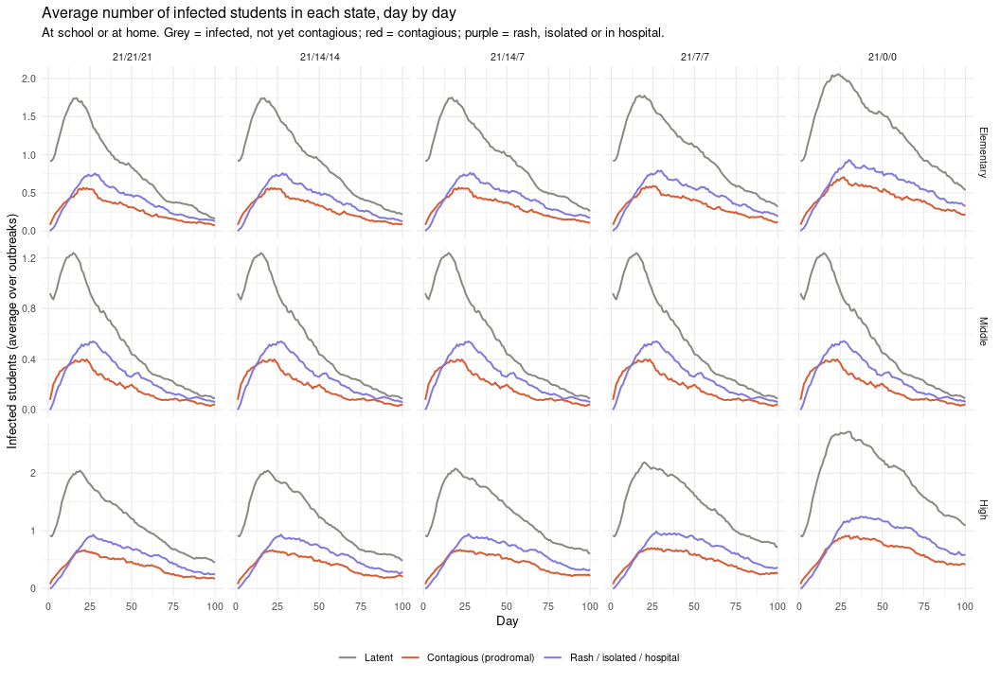

| School     | Strategy | Latent | Prodromal | Rash | Isolated | Isolated Recovered | Quarantined Susceptible | Quarantined Latent | Quarantined Prodromal | Quarantined Recovered | Hospitalized |
|:-----------|:---------|-------:|----------:|-----:|---------:|-------------------:|------------------------:|-------------------:|----------------------:|----------------------:|-------------:|
| Elementary | 21/21/21 |     42 |        12 |    4 |        9 |                  8 |                    1253 |                 42 |                    16 |                     0 |           17 |
| Elementary | 21/14/14 |     46 |        13 |    4 |       10 |                  9 |                    1113 |                 44 |                    17 |                     0 |           18 |
| Elementary | 21/14/7  |     49 |        14 |    5 |       10 |                  9 |                     905 |                 46 |                    17 |                     0 |           19 |
| Elementary | 21/7/7   |     53 |        15 |    5 |       11 |                 10 |                     916 |                 50 |                    19 |                     0 |           20 |
| Elementary | 21/0/0   |     76 |        22 |    7 |       14 |                 12 |                     492 |                 57 |                    22 |                     0 |           26 |
| Middle     | 21/21/21 |     31 |         9 |    3 |        5 |                  5 |                    1749 |                 24 |                     9 |                     0 |           12 |
| Middle     | 21/14/14 |     31 |         9 |    3 |        5 |                  5 |                    1531 |                 24 |                     9 |                     0 |           12 |
| Middle     | 21/14/7  |     31 |         9 |    3 |        5 |                  5 |                    1146 |                 24 |                     9 |                     0 |           12 |
| Middle     | 21/7/7   |     31 |         9 |    3 |        5 |                  5 |                    1144 |                 24 |                     9 |                     0 |           12 |
| Middle     | 21/0/0   |     32 |         9 |    3 |        6 |                  5 |                     551 |                 24 |                     9 |                     0 |           12 |
| High       | 21/21/21 |     52 |        14 |    5 |       13 |                 11 |                    2062 |                 63 |                    25 |                     0 |           25 |
| High       | 21/14/14 |     56 |        16 |    5 |       13 |                 11 |                    1932 |                 64 |                    25 |                     0 |           25 |
| High       | 21/14/7  |     62 |        17 |    5 |       14 |                 12 |                    1729 |                 69 |                    26 |                     0 |           27 |
| High       | 21/7/7   |     69 |        19 |    6 |       16 |                 13 |                    1739 |                 75 |                    28 |                     0 |           30 |
| High       | 21/0/0   |    103 |        29 |    9 |       20 |                 18 |                    1381 |                 90 |                    34 |                     0 |           39 |

Student-days spent in each state per outbreak (average). Example: 12
under Prodromal = 12 contagious student-days at school; Quarantined
Prodromal = contagious days spent at home, where they infect no one.

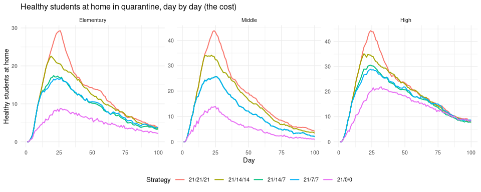

## What is the same in a fair pair, and what is not

Two runs with the same seed under two strategies (say 21/21/21 and
21/0/0):

|                                                                                                                                                                                                             | Same in both runs?                                                                                                                                                                                                                                                            |
|-------------------------------------------------------------------------------------------------------------------------------------------------------------------------------------------------------------|-------------------------------------------------------------------------------------------------------------------------------------------------------------------------------------------------------------------------------------------------------------------------------|
| School, grades, number of students, contact matrix (how often grades mix), transmission rate                                                                                                                | **Same**                                                                                                                                                                                                                                                                      |
| Which students are vaccinated, and who the first case is                                                                                                                                                    | **Same**                                                                                                                                                                                                                                                                      |
| Which vaccinated students are protected (the vaccine is all-or-nothing: each vaccinated student is either fully protected for the whole run, with probability equal to the vaccine efficacy, or not at all) | **Same**                                                                                                                                                                                                                                                                      |
| Each student’s disease course, counted from the day they are infected: days latent, days contagious, day the rash is noticed, hospitalization                                                               | **Same**                                                                                                                                                                                                                                                                      |
| For every pair of students on every day: the coin “do they meet?” and the coin “does this meeting infect?”                                                                                                  | **Same coins**                                                                                                                                                                                                                                                                |
| Who is at home on each day                                                                                                                                                                                  | **Different**: this is the strategy                                                                                                                                                                                                                                           |
| The chance that two students at school meet                                                                                                                                                                 | **Can differ**: each student’s contacts per day with a grade are shared out among the students of that grade *who are at school*. When classmates are at home, the students left at school meet each other more often. The coin is the same, but the bar it must pass is not. |
| Who gets infected, and on which day                                                                                                                                                                         | **Different** after the first detection, as a consequence of the rows above                                                                                                                                                                                                   |

There is **no fixed friendship network**: the model does not decide in
advance which students are friends. Students mix at random by grade each
day, at the rates of the contact matrix. What fair pairs fix is the
*dice*: if students X and Y are both at school on day 38 and X is
contagious, whether they meet and whether Y is infected is decided by
the same coins under both strategies.

Because who is at home differs, the two outbreaks start to differ after
the first detection. Later cases are detected on different days, which
sends different students home at different times, so the differences
grow. The section *Why does an infection happen under one strategy but
not the other?* below counts how often each reason occurs.

## Is the comparison really fair?

Students infected on the same day under two different strategies should
have the same latent and contagious days.

| School | Seeds | Students compared | Same latent and contagious days (21/21/21 vs 21/0/0) |
|:-------|------:|------------------:|:-----------------------------------------------------|
| Middle |   200 |              1217 | 100.0%                                               |

This should be 100% (students still latent on the last day under both
strategies have no contagious period yet and are left out). With the
normal package it is only about 60%.

## How to read the tables

**Table A (outbreak probability).** P(eK) is the share of outbreaks with
at least K infected students. *Difference* is the strategy minus the
reference (*No quarantine* without vaccination, *21/21/21* in the tiered
tables), in **percentage points** with a 95% confidence interval for
**paired** data (Newcombe’s hybrid score method; outbreaks are paired by
seed). A positive value means more outbreaks than the reference; if the
interval includes 0 the two cannot be told apart with this many
outbreaks.

**Table B (run by run).** For each seed, the strategy’s outbreak is
compared with the reference **on the same outbreak**:

- *Mean difference in cases*: average extra (+) or fewer () infected
  students than the reference, with a 95% interval.
- *Fewer / Same / More cases than reference*: how often this strategy
  did better, the same, or worse **on the same outbreak**. Because
  everything else is identical, a “More” outbreak is a real effect of
  the strategy, not chance.
- *Healthy student-days at home*: average days healthy students spent in
  quarantine per outbreak (the cost).

*Unvaccinated students* = enrolment × (1  coverage). Only these students
are quarantined.

## Results by school

### Elementary

**No vaccination: which single tier to quarantine** (compared with no
quarantine)

| Scenario             | Unvaccinated students | P(e10) | P(e20) | P(e50) |   Difference P(e10) |      Difference P(e20) |      Difference P(e50) |
|:---------------------|----------------------:|-------:|-------:|-------:|--------------------:|-----------------------:|-----------------------:|
| No quarantine        |                   156 |  97.5% |  97.5% |  97.2% |           Reference |              Reference |              Reference |
| Only high-risk (21d) |                   156 |  88.9% |  84.9% |  67.7% | -8.6 (-9.9 to -7.4) | -12.6 (-14.1 to -11.2) | -29.6 (-31.6 to -27.6) |
| Only med-risk (21d)  |                   156 |  95.7% |  95.6% |  93.2% | -1.8 (-2.5 to -1.3) |    -1.9 (-2.5 to -1.3) |    -4.0 (-4.9 to -3.2) |
| Only low-risk (21d)  |                   156 |  96.2% |  92.8% |  27.6% | -1.3 (-1.9 to -0.9) |    -4.6 (-5.6 to -3.8) | -69.7 (-71.6 to -67.6) |

| Scenario             | Mean cases |  Mean difference in cases | Fewer cases than reference | Same cases | More cases than reference | Healthy student-days at home |
|:---------------------|-----------:|--------------------------:|---------------------------:|-----------:|--------------------------:|-----------------------------:|
| No quarantine        |      131.2 |                 Reference |                            |            |                           |                         3003 |
| Only high-risk (21d) |       57.6 | -73.59 (-74.91 to -72.27) |                      97.5% |       2.5% |                      0.1% |                         4527 |
| Only med-risk (21d)  |       96.7 | -34.47 (-35.54 to -33.39) |                      94.5% |       2.9% |                      2.5% |                         4423 |
| Only low-risk (21d)  |       40.1 | -91.14 (-92.26 to -90.02) |                      97.5% |       2.4% |                      0.1% |                         7383 |

**Tiered strategies (high/medium/low days): outbreak probability**,
compared with 21/21/21 at the same coverage

*50% vaccinated*

| Strategy | Unvaccinated students | P(e10) | P(e20) | P(e50) |      Difference P(e10) |      Difference P(e20) |   Difference P(e50) |
|:---------|----------------------:|-------:|-------:|-------:|-----------------------:|-----------------------:|--------------------:|
| 21/21/21 |                    78 |  52.0% |  26.3% |   0.4% |              Reference |              Reference |           Reference |
| 21/14/14 |                    78 |  54.4% |  27.1% |   0.1% |    +2.4 (+1.3 to +3.5) |    +0.8 (-0.7 to +2.3) | -0.3 (-0.7 to +0.0) |
| 21/14/7  |                    78 |  56.1% |  32.6% |   0.2% |    +4.1 (+3.0 to +5.2) |    +6.3 (+4.8 to +7.9) | -0.1 (-0.5 to +0.2) |
| 21/7/7   |                    78 |  60.9% |  38.0% |   0.9% |   +8.8 (+7.4 to +10.2) |  +11.6 (+9.9 to +13.4) | +0.5 (+0.0 to +1.0) |
| 21/0/0   |                    78 |  68.5% |  55.0% |   5.1% | +16.4 (+14.7 to +18.0) | +28.7 (+26.7 to +30.8) | +4.7 (+3.8 to +5.7) |

*60% vaccinated*

| Strategy | Unvaccinated students | P(e10) | P(e20) | P(e50) |      Difference P(e10) |      Difference P(e20) |   Difference P(e50) |
|:---------|----------------------:|-------:|-------:|-------:|-----------------------:|-----------------------:|--------------------:|
| 21/21/21 |                    62 |  43.5% |  15.7% |   0.1% |              Reference |              Reference |           Reference |
| 21/14/14 |                    62 |  45.1% |  17.4% |   0.1% |    +1.6 (+0.4 to +2.8) |    +1.8 (+0.4 to +3.2) | +0.0 (-0.2 to +0.2) |
| 21/14/7  |                    62 |  48.8% |  22.8% |   0.0% |    +5.2 (+4.1 to +6.4) |    +7.2 (+5.7 to +8.7) | -0.1 (-0.3 to +0.1) |
| 21/7/7   |                    62 |  52.8% |  26.4% |   0.1% |   +9.3 (+7.8 to +10.6) |  +10.8 (+9.1 to +12.4) | +0.0 (-0.2 to +0.2) |
| 21/0/0   |                    62 |  61.1% |  44.0% |   0.2% | +17.5 (+15.8 to +19.2) | +28.3 (+26.3 to +30.4) | +0.2 (-0.1 to +0.5) |

*70% vaccinated*

| Strategy | Unvaccinated students | P(e10) | P(e20) | P(e50) |      Difference P(e10) |      Difference P(e20) |   Difference P(e50) |
|:---------|----------------------:|-------:|-------:|-------:|-----------------------:|-----------------------:|--------------------:|
| 21/21/21 |                    47 |  27.7% |   5.1% |   0.0% |              Reference |              Reference |           Reference |
| 21/14/14 |                    47 |  30.2% |   6.2% |   0.0% |    +2.5 (+1.5 to +3.6) |    +1.1 (+0.1 to +2.1) | +0.0 (-0.2 to +0.2) |
| 21/14/7  |                    47 |  32.6% |   8.6% |   0.0% |    +4.9 (+3.8 to +6.0) |    +3.5 (+2.5 to +4.6) | +0.0 (-0.2 to +0.2) |
| 21/7/7   |                    47 |  36.8% |  10.9% |   0.0% |   +9.1 (+7.8 to +10.5) |    +5.8 (+4.7 to +7.1) | +0.0 (-0.2 to +0.2) |
| 21/0/0   |                    47 |  46.1% |  23.4% |   0.0% | +18.4 (+16.6 to +20.1) | +18.4 (+16.7 to +20.2) | +0.0 (-0.2 to +0.2) |

*80% vaccinated*

| Strategy | Unvaccinated students | P(e10) | P(e20) | P(e50) |      Difference P(e10) |   Difference P(e20) |   Difference P(e50) |
|:---------|----------------------:|-------:|-------:|-------:|-----------------------:|--------------------:|--------------------:|
| 21/21/21 |                    31 |  12.9% |   0.7% |   0.0% |              Reference |           Reference |           Reference |
| 21/14/14 |                    31 |  15.6% |   0.9% |   0.0% |    +2.6 (+1.7 to +3.6) | +0.2 (-0.3 to +0.6) | +0.0 (-0.2 to +0.2) |
| 21/14/7  |                    31 |  17.0% |   1.5% |   0.0% |    +4.1 (+3.1 to +5.0) | +0.8 (+0.4 to +1.2) | +0.0 (-0.2 to +0.2) |
| 21/7/7   |                    31 |  19.4% |   1.8% |   0.0% |    +6.5 (+5.3 to +7.7) | +1.1 (+0.7 to +1.7) | +0.0 (-0.2 to +0.2) |
| 21/0/0   |                    31 |  26.2% |   4.7% |   0.0% | +13.3 (+11.8 to +14.8) | +4.0 (+3.1 to +5.0) | +0.0 (-0.2 to +0.2) |

*90% vaccinated*

| Strategy | Unvaccinated students | P(e10) | P(e20) | P(e50) |   Difference P(e10) |   Difference P(e20) |   Difference P(e50) |
|:---------|----------------------:|-------:|-------:|-------:|--------------------:|--------------------:|--------------------:|
| 21/21/21 |                    16 |   1.6% |   0.0% |   0.0% |           Reference |           Reference |           Reference |
| 21/14/14 |                    16 |   1.5% |   0.0% |   0.0% | -0.1 (-0.5 to +0.3) | +0.0 (-0.2 to +0.2) | +0.0 (-0.2 to +0.2) |
| 21/14/7  |                    16 |   2.3% |   0.0% |   0.0% | +0.8 (+0.3 to +1.3) | +0.0 (-0.2 to +0.2) | +0.0 (-0.2 to +0.2) |
| 21/7/7   |                    16 |   2.9% |   0.0% |   0.0% | +1.3 (+0.8 to +1.9) | +0.0 (-0.2 to +0.2) | +0.0 (-0.2 to +0.2) |
| 21/0/0   |                    16 |   4.8% |   0.0% |   0.0% | +3.2 (+2.5 to +4.1) | +0.0 (-0.2 to +0.2) | +0.0 (-0.2 to +0.2) |

*95% vaccinated*

| Strategy | Unvaccinated students | P(e10) | P(e20) | P(e50) |   Difference P(e10) |   Difference P(e20) |   Difference P(e50) |
|:---------|----------------------:|-------:|-------:|-------:|--------------------:|--------------------:|--------------------:|
| 21/21/21 |                     8 |   0.1% |   0.0% |   0.0% |           Reference |           Reference |           Reference |
| 21/14/14 |                     8 |   0.1% |   0.0% |   0.0% | +0.0 (-0.2 to +0.2) | +0.0 (-0.2 to +0.2) | +0.0 (-0.2 to +0.2) |
| 21/14/7  |                     8 |   0.1% |   0.0% |   0.0% | +0.0 (-0.2 to +0.2) | +0.0 (-0.2 to +0.2) | +0.0 (-0.2 to +0.2) |
| 21/7/7   |                     8 |   0.2% |   0.0% |   0.0% | +0.1 (-0.1 to +0.3) | +0.0 (-0.2 to +0.2) | +0.0 (-0.2 to +0.2) |
| 21/0/0   |                     8 |   0.4% |   0.0% |   0.0% | +0.2 (-0.0 to +0.5) | +0.0 (-0.2 to +0.2) | +0.0 (-0.2 to +0.2) |

**Tiered strategies: run by run against 21/21/21 on the same outbreak**

| Coverage | Strategy | Mean cases | Mean difference in cases | Fewer cases than reference | Same cases | More cases than reference | Healthy student-days at home |
|:---------|:---------|-----------:|-------------------------:|---------------------------:|-----------:|--------------------------:|-----------------------------:|
| 50%      | 21/21/21 |       13.1 |                Reference |                            |            |                           |                         2536 |
| 50%      | 21/14/14 |       13.4 |   +0.33 (+0.05 to +0.61) |                      19.4% |      57.8% |                     22.8% |                         2386 |
| 50%      | 21/14/7  |       14.7 |   +1.63 (+1.36 to +1.91) |                      12.8% |      56.9% |                     30.3% |                         2039 |
| 50%      | 21/7/7   |       16.4 |   +3.30 (+2.94 to +3.66) |                      11.6% |      48.9% |                     39.5% |                         2073 |
| 50%      | 21/0/0   |       23.1 | +10.00 (+9.46 to +10.54) |                       4.5% |      34.4% |                     61.2% |                         1292 |
| 60%      | 21/21/21 |       10.3 |                Reference |                            |            |                           |                         1903 |
| 60%      | 21/14/14 |       10.7 |   +0.45 (+0.23 to +0.67) |                      15.3% |      63.4% |                     21.2% |                         1749 |
| 60%      | 21/14/7  |       11.8 |   +1.52 (+1.29 to +1.76) |                       9.7% |      62.2% |                     28.2% |                         1465 |
| 60%      | 21/7/7   |       12.8 |   +2.56 (+2.27 to +2.84) |                       8.2% |      54.5% |                     37.2% |                         1474 |
| 60%      | 21/0/0   |       17.5 |   +7.26 (+6.84 to +7.67) |                       2.9% |      38.6% |                     58.5% |                          866 |
| 70%      | 21/21/21 |        6.9 |                Reference |                            |            |                           |                         1240 |
| 70%      | 21/14/14 |        7.3 |   +0.39 (+0.26 to +0.51) |                       8.9% |      76.1% |                     15.0% |                         1102 |
| 70%      | 21/14/7  |        7.7 |   +0.83 (+0.70 to +0.96) |                       5.5% |      73.7% |                     20.8% |                          884 |
| 70%      | 21/7/7   |        8.5 |   +1.57 (+1.39 to +1.75) |                       5.3% |      66.1% |                     28.6% |                          894 |
| 70%      | 21/0/0   |       11.1 |   +4.21 (+3.92 to +4.51) |                       2.5% |      52.0% |                     45.4% |                          480 |
| 80%      | 21/21/21 |        4.6 |                Reference |                            |            |                           |                          746 |
| 80%      | 21/14/14 |        4.9 |   +0.29 (+0.22 to +0.36) |                       3.6% |      85.4% |                     11.1% |                          638 |
| 80%      | 21/14/7  |        5.1 |   +0.47 (+0.39 to +0.54) |                       1.8% |      84.2% |                     14.0% |                          488 |
| 80%      | 21/7/7   |        5.4 |   +0.80 (+0.69 to +0.90) |                       1.7% |      77.5% |                     20.8% |                          481 |
| 80%      | 21/0/0   |        6.4 |   +1.78 (+1.62 to +1.94) |                       1.4% |      65.5% |                     33.1% |                          230 |
| 90%      | 21/21/21 |        2.7 |                Reference |                            |            |                           |                          309 |
| 90%      | 21/14/14 |        2.8 |   +0.07 (+0.04 to +0.10) |                       1.1% |      94.8% |                      4.2% |                          247 |
| 90%      | 21/14/7  |        2.9 |   +0.13 (+0.10 to +0.16) |                       0.4% |      93.5% |                      6.1% |                          178 |
| 90%      | 21/7/7   |        2.9 |   +0.21 (+0.17 to +0.25) |                       0.4% |      90.3% |                      9.2% |                          169 |
| 90%      | 21/0/0   |        3.2 |   +0.44 (+0.37 to +0.50) |                       0.5% |      84.6% |                     14.9% |                           72 |
| 95%      | 21/21/21 |        1.9 |                Reference |                            |            |                           |                          135 |
| 95%      | 21/14/14 |        1.9 |   +0.02 (+0.01 to +0.03) |                       0.2% |      98.5% |                      1.3% |                          102 |
| 95%      | 21/14/7  |        1.9 |   +0.02 (+0.01 to +0.03) |                       0.2% |      98.1% |                      1.7% |                           71 |
| 95%      | 21/7/7   |        1.9 |   +0.04 (+0.03 to +0.06) |                       0.2% |      96.9% |                      2.9% |                           66 |
| 95%      | 21/0/0   |        2.0 |   +0.11 (+0.08 to +0.13) |                       0.2% |      94.2% |                      5.7% |                           28 |

### Middle

**No vaccination: which single tier to quarantine** (compared with no
quarantine)

| Scenario             | Unvaccinated students | P(e10) | P(e20) | P(e50) |      Difference P(e10) |      Difference P(e20) |      Difference P(e50) |
|:---------------------|----------------------:|-------:|-------:|-------:|-----------------------:|-----------------------:|-----------------------:|
| No quarantine        |                   236 |  92.8% |  92.5% |  90.8% |              Reference |              Reference |              Reference |
| Only high-risk (21d) |                   236 |  68.5% |  51.4% |   6.8% | -24.3 (-26.2 to -22.4) | -41.1 (-43.2 to -38.9) | -84.0 (-85.5 to -82.3) |
| Only med-risk (21d)  |                   236 |  92.8% |  92.5% |  90.4% |    +0.0 (-0.2 to +0.2) |    +0.0 (-0.2 to +0.2) |    -0.4 (-0.7 to -0.1) |
| Only low-risk (21d)  |                   236 |  92.7% |  92.1% |  86.0% |    -0.0 (-0.2 to +0.1) |    -0.4 (-0.8 to -0.1) |    -4.8 (-5.8 to -3.9) |

| Scenario             | Mean cases |  Mean difference in cases | Fewer cases than reference | Same cases | More cases than reference | Healthy student-days at home |
|:---------------------|-----------:|--------------------------:|---------------------------:|-----------:|--------------------------:|-----------------------------:|
| No quarantine        |       75.2 |                 Reference |                            |            |                           |                         5413 |
| Only high-risk (21d) |       22.2 | -53.08 (-54.40 to -51.76) |                      92.2% |       7.4% |                      0.4% |                         4431 |
| Only med-risk (21d)  |       67.9 |    -7.34 (-8.03 to -6.65) |                      40.5% |      48.4% |                     11.1% |                         5331 |
| Only low-risk (21d)  |       52.0 | -23.18 (-24.21 to -22.16) |                      66.7% |      33.0% |                      0.3% |                        11969 |

**Tiered strategies (high/medium/low days): outbreak probability**,
compared with 21/21/21 at the same coverage

*50% vaccinated*

| Strategy | Unvaccinated students | P(e10) | P(e20) | P(e50) |   Difference P(e10) |   Difference P(e20) |   Difference P(e50) |
|:---------|----------------------:|-------:|-------:|-------:|--------------------:|--------------------:|--------------------:|
| 21/21/21 |                   118 |  35.1% |  11.8% |   0.0% |           Reference |           Reference |           Reference |
| 21/14/14 |                   118 |  35.2% |  11.6% |   0.0% | +0.2 (-0.1 to +0.4) | -0.2 (-0.6 to +0.1) | +0.0 (-0.2 to +0.2) |
| 21/14/7  |                   118 |  35.5% |  12.0% |   0.0% | +0.4 (+0.1 to +0.7) | +0.2 (-0.1 to +0.5) | +0.0 (-0.2 to +0.2) |
| 21/7/7   |                   118 |  35.5% |  12.1% |   0.0% | +0.5 (+0.1 to +0.8) | +0.3 (-0.1 to +0.7) | +0.0 (-0.2 to +0.2) |
| 21/0/0   |                   118 |  36.2% |  13.0% |   0.1% | +1.1 (+0.6 to +1.6) | +1.2 (+0.7 to +1.7) | +0.1 (-0.1 to +0.3) |

*60% vaccinated*

| Strategy | Unvaccinated students | P(e10) | P(e20) | P(e50) |   Difference P(e10) |   Difference P(e20) |   Difference P(e50) |
|:---------|----------------------:|-------:|-------:|-------:|--------------------:|--------------------:|--------------------:|
| 21/21/21 |                    94 |  25.9% |   3.9% |   0.0% |           Reference |           Reference |           Reference |
| 21/14/14 |                    94 |  26.1% |   4.0% |   0.0% | +0.2 (-0.1 to +0.5) | +0.1 (-0.2 to +0.4) | +0.0 (-0.2 to +0.2) |
| 21/14/7  |                    94 |  26.2% |   4.2% |   0.0% | +0.3 (+0.0 to +0.6) | +0.3 (+0.0 to +0.6) | +0.0 (-0.2 to +0.2) |
| 21/7/7   |                    94 |  26.2% |   4.2% |   0.0% | +0.4 (+0.0 to +0.7) | +0.4 (+0.1 to +0.7) | +0.0 (-0.2 to +0.2) |
| 21/0/0   |                    94 |  26.7% |   4.5% |   0.0% | +0.8 (+0.3 to +1.2) | +0.5 (+0.2 to +1.0) | +0.0 (-0.2 to +0.2) |

*70% vaccinated*

| Strategy | Unvaccinated students | P(e10) | P(e20) | P(e50) |   Difference P(e10) |   Difference P(e20) |   Difference P(e50) |
|:---------|----------------------:|-------:|-------:|-------:|--------------------:|--------------------:|--------------------:|
| 21/21/21 |                    71 |  15.0% |   0.9% |   0.0% |           Reference |           Reference |           Reference |
| 21/14/14 |                    71 |  15.0% |   0.9% |   0.0% | +0.1 (-0.2 to +0.3) | +0.0 (-0.2 to +0.2) | +0.0 (-0.2 to +0.2) |
| 21/14/7  |                    71 |  15.2% |   0.9% |   0.0% | +0.2 (-0.1 to +0.4) | +0.0 (-0.2 to +0.3) | +0.0 (-0.2 to +0.2) |
| 21/7/7   |                    71 |  15.2% |   0.9% |   0.0% | +0.2 (-0.1 to +0.4) | +0.0 (-0.2 to +0.3) | +0.0 (-0.2 to +0.2) |
| 21/0/0   |                    71 |  15.6% |   1.3% |   0.0% | +0.6 (+0.2 to +1.0) | +0.4 (+0.2 to +0.8) | +0.0 (-0.2 to +0.2) |

*80% vaccinated*

| Strategy | Unvaccinated students | P(e10) | P(e20) | P(e50) |   Difference P(e10) |   Difference P(e20) |   Difference P(e50) |
|:---------|----------------------:|-------:|-------:|-------:|--------------------:|--------------------:|--------------------:|
| 21/21/21 |                    47 |   6.6% |   0.0% |   0.0% |           Reference |           Reference |           Reference |
| 21/14/14 |                    47 |   6.7% |   0.0% |   0.0% | +0.1 (-0.1 to +0.2) | +0.0 (-0.2 to +0.2) | +0.0 (-0.2 to +0.2) |
| 21/14/7  |                    47 |   6.7% |   0.0% |   0.0% | +0.1 (-0.2 to +0.3) | +0.0 (-0.2 to +0.2) | +0.0 (-0.2 to +0.2) |
| 21/7/7   |                    47 |   6.7% |   0.0% |   0.0% | +0.1 (-0.2 to +0.3) | +0.0 (-0.2 to +0.2) | +0.0 (-0.2 to +0.2) |
| 21/0/0   |                    47 |   6.9% |   0.0% |   0.0% | +0.3 (+0.0 to +0.6) | +0.0 (-0.2 to +0.2) | +0.0 (-0.2 to +0.2) |

*90% vaccinated*

| Strategy | Unvaccinated students | P(e10) | P(e20) | P(e50) |   Difference P(e10) |   Difference P(e20) |   Difference P(e50) |
|:---------|----------------------:|-------:|-------:|-------:|--------------------:|--------------------:|--------------------:|
| 21/21/21 |                    24 |   0.7% |   0.0% |   0.0% |           Reference |           Reference |           Reference |
| 21/14/14 |                    24 |   0.7% |   0.0% |   0.0% | +0.0 (-0.2 to +0.2) | +0.0 (-0.2 to +0.2) | +0.0 (-0.2 to +0.2) |
| 21/14/7  |                    24 |   0.7% |   0.0% |   0.0% | +0.0 (-0.2 to +0.2) | +0.0 (-0.2 to +0.2) | +0.0 (-0.2 to +0.2) |
| 21/7/7   |                    24 |   0.7% |   0.0% |   0.0% | +0.0 (-0.2 to +0.2) | +0.0 (-0.2 to +0.2) | +0.0 (-0.2 to +0.2) |
| 21/0/0   |                    24 |   0.7% |   0.0% |   0.0% | +0.0 (-0.2 to +0.2) | +0.0 (-0.2 to +0.2) | +0.0 (-0.2 to +0.2) |

*95% vaccinated*

| Strategy | Unvaccinated students | P(e10) | P(e20) | P(e50) |   Difference P(e10) |   Difference P(e20) |   Difference P(e50) |
|:---------|----------------------:|-------:|-------:|-------:|--------------------:|--------------------:|--------------------:|
| 21/21/21 |                    12 |   0.1% |   0.0% |   0.0% |           Reference |           Reference |           Reference |
| 21/14/14 |                    12 |   0.1% |   0.0% |   0.0% | +0.0 (-0.2 to +0.2) | +0.0 (-0.2 to +0.2) | +0.0 (-0.2 to +0.2) |
| 21/14/7  |                    12 |   0.1% |   0.0% |   0.0% | +0.0 (-0.2 to +0.2) | +0.0 (-0.2 to +0.2) | +0.0 (-0.2 to +0.2) |
| 21/7/7   |                    12 |   0.1% |   0.0% |   0.0% | +0.0 (-0.2 to +0.2) | +0.0 (-0.2 to +0.2) | +0.0 (-0.2 to +0.2) |
| 21/0/0   |                    12 |   0.1% |   0.0% |   0.0% | +0.0 (-0.2 to +0.2) | +0.0 (-0.2 to +0.2) | +0.0 (-0.2 to +0.2) |

**Tiered strategies: run by run against 21/21/21 on the same outbreak**

| Coverage | Strategy | Mean cases | Mean difference in cases | Fewer cases than reference | Same cases | More cases than reference | Healthy student-days at home |
|:---------|:---------|-----------:|-------------------------:|---------------------------:|-----------:|--------------------------:|-----------------------------:|
| 50%      | 21/21/21 |        8.5 |                Reference |                            |            |                           |                         3616 |
| 50%      | 21/14/14 |        8.5 |   +0.01 (-0.03 to +0.04) |                       1.4% |      97.7% |                      0.9% |                         3316 |
| 50%      | 21/14/7  |        8.6 |   +0.07 (+0.02 to +0.11) |                       0.8% |      97.6% |                      1.7% |                         2618 |
| 50%      | 21/7/7   |        8.6 |   +0.09 (+0.04 to +0.14) |                       0.7% |      97.4% |                      1.9% |                         2617 |
| 50%      | 21/0/0   |        8.8 |   +0.34 (+0.26 to +0.43) |                       0.1% |      94.2% |                      5.8% |                         1300 |
| 60%      | 21/21/21 |        6.6 |                Reference |                            |            |                           |                         2642 |
| 60%      | 21/14/14 |        6.6 |   +0.04 (+0.00 to +0.07) |                       0.7% |      98.4% |                      0.9% |                         2396 |
| 60%      | 21/14/7  |        6.7 |   +0.07 (+0.03 to +0.11) |                       0.3% |      98.5% |                      1.2% |                         1853 |
| 60%      | 21/7/7   |        6.7 |   +0.08 (+0.04 to +0.12) |                       0.2% |      98.2% |                      1.6% |                         1850 |
| 60%      | 21/0/0   |        6.8 |   +0.17 (+0.11 to +0.22) |                       0.1% |      96.2% |                      3.7% |                          895 |
| 70%      | 21/21/21 |        4.9 |                Reference |                            |            |                           |                         1758 |
| 70%      | 21/14/14 |        4.9 |   +0.00 (-0.01 to +0.01) |                       0.4% |      99.3% |                      0.2% |                         1545 |
| 70%      | 21/14/7  |        4.9 |   +0.01 (-0.00 to +0.03) |                       0.1% |      99.3% |                      0.5% |                         1158 |
| 70%      | 21/7/7   |        4.9 |   +0.02 (-0.00 to +0.03) |                       0.1% |      99.2% |                      0.7% |                         1156 |
| 70%      | 21/0/0   |        4.9 |   +0.09 (+0.05 to +0.12) |                       0.0% |      97.7% |                      2.3% |                          558 |
| 80%      | 21/21/21 |        3.4 |                Reference |                            |            |                           |                         1034 |
| 80%      | 21/14/14 |        3.4 |   +0.00 (-0.00 to +0.00) |                       0.1% |      99.7% |                      0.1% |                          881 |
| 80%      | 21/14/7  |        3.4 |   +0.00 (-0.00 to +0.01) |                       0.1% |      99.8% |                      0.1% |                          642 |
| 80%      | 21/7/7   |        3.4 |   +0.01 (-0.00 to +0.02) |                       0.1% |      99.5% |                      0.4% |                          641 |
| 80%      | 21/0/0   |        3.5 |   +0.04 (+0.02 to +0.05) |                       0.0% |      98.6% |                      1.5% |                          309 |
| 90%      | 21/21/21 |        2.2 |                Reference |                            |            |                           |                          449 |
| 90%      | 21/14/14 |        2.2 |   +0.00 (-0.00 to +0.00) |                       0.0% |      99.9% |                      0.1% |                          360 |
| 90%      | 21/14/7  |        2.2 |   +0.00 (-0.00 to +0.01) |                       0.0% |      99.8% |                      0.2% |                          254 |
| 90%      | 21/7/7   |        2.2 |   +0.00 (+0.00 to +0.01) |                       0.0% |      99.8% |                      0.2% |                          253 |
| 90%      | 21/0/0   |        2.2 |   +0.01 (+0.00 to +0.01) |                       0.0% |      99.6% |                      0.4% |                          126 |
| 95%      | 21/21/21 |        1.7 |                Reference |                            |            |                           |                          199 |
| 95%      | 21/14/14 |        1.7 |   +0.00 (+0.00 to +0.00) |                       0.0% |     100.0% |                      0.0% |                          155 |
| 95%      | 21/14/7  |        1.7 |   +0.00 (-0.00 to +0.00) |                       0.0% |     100.0% |                      0.1% |                          105 |
| 95%      | 21/7/7   |        1.7 |   +0.00 (-0.00 to +0.00) |                       0.0% |     100.0% |                      0.1% |                          105 |
| 95%      | 21/0/0   |        1.7 |   +0.00 (-0.00 to +0.00) |                       0.0% |      99.9% |                      0.1% |                           53 |

### High

**No vaccination: which single tier to quarantine** (compared with no
quarantine)

| Scenario             | Unvaccinated students | P(e10) | P(e20) | P(e50) |   Difference P(e10) |   Difference P(e20) |      Difference P(e50) |
|:---------------------|----------------------:|-------:|-------:|-------:|--------------------:|--------------------:|-----------------------:|
| No quarantine        |                   232 |  97.6% |  97.5% |  97.5% |           Reference |           Reference |              Reference |
| Only high-risk (21d) |                   232 |  93.9% |  92.0% |  79.7% | -3.7 (-4.6 to -2.9) | -5.5 (-6.6 to -4.6) | -17.8 (-19.5 to -16.2) |
| Only med-risk (21d)  |                   232 |  94.3% |  94.2% |  94.0% | -3.3 (-4.2 to -2.6) | -3.4 (-4.2 to -2.6) |    -3.4 (-4.3 to -2.7) |
| Only low-risk (21d)  |                   232 |  95.7% |  92.2% |  70.0% | -1.9 (-2.6 to -1.3) | -5.4 (-6.5 to -4.5) | -27.4 (-29.4 to -25.5) |

| Scenario             | Mean cases |     Mean difference in cases | Fewer cases than reference | Same cases | More cases than reference | Healthy student-days at home |
|:---------------------|-----------:|-----------------------------:|---------------------------:|-----------:|--------------------------:|-----------------------------:|
| No quarantine        |      181.5 |                    Reference |                            |            |                           |                         5868 |
| Only high-risk (21d) |       72.9 | -108.53 (-110.12 to -106.94) |                      97.5% |       2.5% |                      0.0% |                         9553 |
| Only med-risk (21d)  |      135.9 |    -45.59 (-47.08 to -44.09) |                      94.7% |       2.8% |                      2.5% |                         8031 |
| Only low-risk (21d)  |       61.4 | -120.07 (-121.62 to -118.52) |                      97.5% |       2.5% |                      0.0% |                        11542 |

**Tiered strategies (high/medium/low days): outbreak probability**,
compared with 21/21/21 at the same coverage

*50% vaccinated*

| Strategy | Unvaccinated students | P(e10) | P(e20) | P(e50) |      Difference P(e10) |      Difference P(e20) |      Difference P(e50) |
|:---------|----------------------:|-------:|-------:|-------:|-----------------------:|-----------------------:|-----------------------:|
| 21/21/21 |                   116 |  61.3% |  41.7% |   5.3% |              Reference |              Reference |              Reference |
| 21/14/14 |                   116 |  64.9% |  43.7% |   4.4% |    +3.6 (+2.4 to +4.8) |    +2.0 (+0.2 to +3.8) |    -1.0 (-2.0 to +0.1) |
| 21/14/7  |                   116 |  66.9% |  50.8% |   6.3% |    +5.6 (+4.4 to +6.8) |   +9.1 (+7.4 to +10.9) |    +1.0 (-0.1 to +2.1) |
| 21/7/7   |                   116 |  71.5% |  57.1% |   9.2% |  +10.2 (+8.7 to +11.6) | +15.4 (+13.5 to +17.3) |    +3.9 (+2.6 to +5.2) |
| 21/0/0   |                   116 |  80.3% |  72.7% |  22.7% | +19.1 (+17.3 to +20.8) | +31.0 (+28.8 to +33.0) | +17.3 (+15.5 to +19.2) |

*60% vaccinated*

| Strategy | Unvaccinated students | P(e10) | P(e20) | P(e50) |      Difference P(e10) |      Difference P(e20) |   Difference P(e50) |
|:---------|----------------------:|-------:|-------:|-------:|-----------------------:|-----------------------:|--------------------:|
| 21/21/21 |                    93 |  51.3% |  31.4% |   1.5% |              Reference |              Reference |           Reference |
| 21/14/14 |                    93 |  55.8% |  32.4% |   1.1% |    +4.4 (+3.1 to +5.7) |    +1.1 (-0.6 to +2.7) | -0.4 (-1.0 to +0.2) |
| 21/14/7  |                    93 |  58.9% |  39.2% |   2.1% |    +7.6 (+6.3 to +8.8) |    +7.9 (+6.1 to +9.6) | +0.6 (-0.1 to +1.3) |
| 21/7/7   |                    93 |  64.5% |  43.6% |   2.5% | +13.2 (+11.5 to +14.8) | +12.3 (+10.3 to +14.3) | +1.0 (+0.3 to +1.8) |
| 21/0/0   |                    93 |  73.4% |  62.5% |   6.2% | +22.0 (+20.1 to +23.8) | +31.1 (+28.9 to +33.2) | +4.7 (+3.6 to +5.8) |

*70% vaccinated*

| Strategy | Unvaccinated students | P(e10) | P(e20) | P(e50) |      Difference P(e10) |      Difference P(e20) |   Difference P(e50) |
|:---------|----------------------:|-------:|-------:|-------:|-----------------------:|-----------------------:|--------------------:|
| 21/21/21 |                    70 |  39.6% |  18.3% |   0.1% |              Reference |              Reference |           Reference |
| 21/14/14 |                    70 |  42.8% |  18.6% |   0.1% |    +3.2 (+2.0 to +4.4) |    +0.4 (-1.0 to +1.7) | +0.1 (-0.2 to +0.3) |
| 21/14/7  |                    70 |  45.8% |  23.8% |   0.1% |    +6.2 (+4.9 to +7.5) |    +5.5 (+4.1 to +6.9) | +0.1 (-0.2 to +0.3) |
| 21/7/7   |                    70 |  50.1% |  28.5% |   0.1% |  +10.6 (+9.1 to +12.1) |  +10.2 (+8.6 to +11.9) | +0.1 (-0.2 to +0.3) |
| 21/0/0   |                    70 |  60.2% |  43.5% |   0.4% | +20.6 (+18.8 to +22.4) | +25.2 (+23.2 to +27.2) | +0.3 (+0.0 to +0.7) |

*80% vaccinated*

| Strategy | Unvaccinated students | P(e10) | P(e20) | P(e50) |      Difference P(e10) |      Difference P(e20) |   Difference P(e50) |
|:---------|----------------------:|-------:|-------:|-------:|-----------------------:|-----------------------:|--------------------:|
| 21/21/21 |                    46 |  24.9% |   5.1% |   0.0% |              Reference |              Reference |           Reference |
| 21/14/14 |                    46 |  27.8% |   5.5% |   0.0% |    +2.9 (+1.8 to +4.0) |    +0.4 (-0.4 to +1.3) | +0.0 (-0.2 to +0.2) |
| 21/14/7  |                    46 |  29.8% |   6.8% |   0.0% |    +4.9 (+3.8 to +6.1) |    +1.8 (+0.9 to +2.7) | +0.0 (-0.2 to +0.2) |
| 21/7/7   |                    46 |  35.0% |   8.6% |   0.0% |  +10.2 (+8.8 to +11.6) |    +3.6 (+2.5 to +4.7) | +0.0 (-0.2 to +0.2) |
| 21/0/0   |                    46 |  43.2% |  18.2% |   0.0% | +18.4 (+16.7 to +20.1) | +13.2 (+11.6 to +14.7) | +0.0 (-0.2 to +0.2) |

*90% vaccinated*

| Strategy | Unvaccinated students | P(e10) | P(e20) | P(e50) |   Difference P(e10) |   Difference P(e20) |   Difference P(e50) |
|:---------|----------------------:|-------:|-------:|-------:|--------------------:|--------------------:|--------------------:|
| 21/21/21 |                    23 |   6.9% |   0.2% |   0.0% |           Reference |           Reference |           Reference |
| 21/14/14 |                    23 |   8.0% |   0.3% |   0.0% | +1.1 (+0.5 to +1.7) | +0.1 (-0.1 to +0.4) | +0.0 (-0.2 to +0.2) |
| 21/14/7  |                    23 |   8.8% |   0.3% |   0.0% | +1.9 (+1.3 to +2.7) | +0.1 (-0.1 to +0.4) | +0.0 (-0.2 to +0.2) |
| 21/7/7   |                    23 |  10.4% |   0.4% |   0.0% | +3.5 (+2.7 to +4.5) | +0.2 (-0.1 to +0.5) | +0.0 (-0.2 to +0.2) |
| 21/0/0   |                    23 |  15.2% |   1.0% |   0.0% | +8.3 (+7.1 to +9.6) | +0.8 (+0.4 to +1.3) | +0.0 (-0.2 to +0.2) |

*95% vaccinated*

| Strategy | Unvaccinated students | P(e10) | P(e20) | P(e50) |   Difference P(e10) |   Difference P(e20) |   Difference P(e50) |
|:---------|----------------------:|-------:|-------:|-------:|--------------------:|--------------------:|--------------------:|
| 21/21/21 |                    12 |   1.1% |   0.0% |   0.0% |           Reference |           Reference |           Reference |
| 21/14/14 |                    12 |   1.2% |   0.0% |   0.0% | +0.1 (-0.2 to +0.5) | +0.0 (-0.2 to +0.2) | +0.0 (-0.2 to +0.2) |
| 21/14/7  |                    12 |   1.6% |   0.0% |   0.0% | +0.5 (+0.2 to +1.0) | +0.0 (-0.2 to +0.2) | +0.0 (-0.2 to +0.2) |
| 21/7/7   |                    12 |   1.6% |   0.0% |   0.0% | +0.5 (+0.2 to +1.0) | +0.0 (-0.2 to +0.2) | +0.0 (-0.2 to +0.2) |
| 21/0/0   |                    12 |   2.5% |   0.0% |   0.0% | +1.4 (+0.9 to +2.0) | +0.0 (-0.2 to +0.2) | +0.0 (-0.2 to +0.2) |

**Tiered strategies: run by run against 21/21/21 on the same outbreak**

| Coverage | Strategy | Mean cases |  Mean difference in cases | Fewer cases than reference | Same cases | More cases than reference | Healthy student-days at home |
|:---------|:---------|-----------:|--------------------------:|---------------------------:|-----------:|--------------------------:|-----------------------------:|
| 50%      | 21/21/21 |       19.2 |                 Reference |                            |            |                           |                         4189 |
| 50%      | 21/14/14 |       19.4 |    +0.16 (-0.34 to +0.66) |                      29.0% |      41.4% |                     29.5% |                         4105 |
| 50%      | 21/14/7  |       21.8 |    +2.56 (+2.08 to +3.04) |                      20.2% |      40.6% |                     39.2% |                         3838 |
| 50%      | 21/7/7   |       24.3 |    +5.11 (+4.54 to +5.69) |                      18.8% |      32.9% |                     48.4% |                         3889 |
| 50%      | 21/0/0   |       32.8 | +13.62 (+12.87 to +14.37) |                      10.4% |      19.8% |                     69.8% |                         3319 |
| 60%      | 21/21/21 |       14.6 |                 Reference |                            |            |                           |                         3074 |
| 60%      | 21/14/14 |       14.9 |    +0.33 (-0.04 to +0.71) |                      22.0% |      51.2% |                     26.8% |                         2969 |
| 60%      | 21/14/7  |       16.7 |    +2.19 (+1.79 to +2.58) |                      17.2% |      46.5% |                     36.3% |                         2732 |
| 60%      | 21/7/7   |       18.4 |    +3.82 (+3.36 to +4.28) |                      16.6% |      37.8% |                     45.6% |                         2780 |
| 60%      | 21/0/0   |       25.0 |  +10.48 (+9.89 to +11.07) |                       7.6% |      25.1% |                     67.2% |                         2309 |
| 70%      | 21/21/21 |       10.1 |                 Reference |                            |            |                           |                         2090 |
| 70%      | 21/14/14 |       10.7 |    +0.54 (+0.30 to +0.78) |                      15.3% |      60.5% |                     24.2% |                         1959 |
| 70%      | 21/14/7  |       11.5 |    +1.37 (+1.13 to +1.61) |                      12.7% |      57.4% |                     30.0% |                         1751 |
| 70%      | 21/7/7   |       12.7 |    +2.58 (+2.28 to +2.87) |                      10.9% |      50.0% |                     39.1% |                         1764 |
| 70%      | 21/0/0   |       16.8 |    +6.72 (+6.30 to +7.13) |                       5.3% |      35.4% |                     59.4% |                         1383 |
| 80%      | 21/21/21 |        6.4 |                 Reference |                            |            |                           |                         1213 |
| 80%      | 21/14/14 |        6.7 |    +0.33 (+0.21 to +0.45) |                       8.4% |      75.4% |                     16.2% |                         1096 |
| 80%      | 21/14/7  |        7.1 |    +0.69 (+0.56 to +0.81) |                       7.1% |      70.0% |                     22.9% |                          950 |
| 80%      | 21/7/7   |        7.8 |    +1.39 (+1.22 to +1.56) |                       6.4% |      62.8% |                     30.8% |                          943 |
| 80%      | 21/0/0   |        9.9 |    +3.48 (+3.22 to +3.74) |                       4.2% |      48.5% |                     47.3% |                          683 |
| 90%      | 21/21/21 |        3.4 |                 Reference |                            |            |                           |                          484 |
| 90%      | 21/14/14 |        3.6 |    +0.14 (+0.09 to +0.18) |                       2.4% |      89.6% |                      8.0% |                          413 |
| 90%      | 21/14/7  |        3.7 |    +0.25 (+0.20 to +0.30) |                       2.2% |      86.2% |                     11.7% |                          340 |
| 90%      | 21/7/7   |        3.9 |    +0.42 (+0.35 to +0.48) |                       1.8% |      82.6% |                     15.7% |                          323 |
| 90%      | 21/0/0   |        4.4 |    +0.96 (+0.86 to +1.06) |                       1.0% |      73.2% |                     25.8% |                          213 |
| 95%      | 21/21/21 |        2.2 |                 Reference |                            |            |                           |                          212 |
| 95%      | 21/14/14 |        2.3 |    +0.05 (+0.03 to +0.07) |                       0.6% |      96.2% |                      3.2% |                          171 |
| 95%      | 21/14/7  |        2.3 |    +0.09 (+0.07 to +0.11) |                       0.3% |      94.9% |                      4.8% |                          135 |
| 95%      | 21/7/7   |        2.4 |    +0.14 (+0.11 to +0.18) |                       0.3% |      92.6% |                      7.1% |                          125 |
| 95%      | 21/0/0   |        2.5 |    +0.25 (+0.21 to +0.29) |                       0.4% |      88.0% |                     11.6% |                           74 |

## Summary across schools

The figure shows the average change in cases compared with 21/21/21 on
the same outbreak. The table shows, for each other strategy, how often
21/21/21 ended with **strictly fewer** cases (21/21/21 did better),
**the same** number, or **strictly more** cases (21/21/21 backfired) on
the same outbreak.

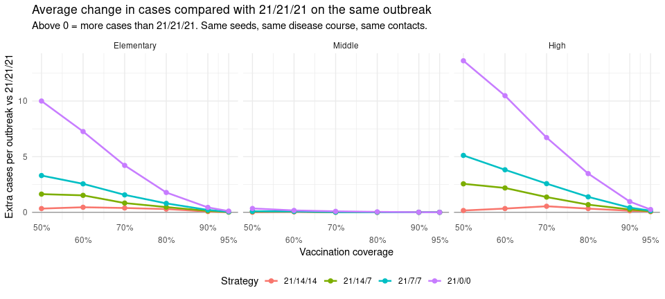

| School     | Coverage | Compared with | 21/21/21 strictly fewer cases | Same number of cases | 21/21/21 strictly more cases |
|:-----------|:---------|:--------------|------------------------------:|---------------------:|-----------------------------:|
| Elementary | 50%      | 21/14/14      |                         22.8% |                57.8% |                        19.4% |
| Elementary | 50%      | 21/14/7       |                         30.3% |                56.9% |                        12.8% |
| Elementary | 50%      | 21/7/7        |                         39.5% |                48.9% |                        11.6% |
| Elementary | 50%      | 21/0/0        |                         61.2% |                34.4% |                         4.5% |
| Elementary | 60%      | 21/14/14      |                         21.2% |                63.4% |                        15.3% |
| Elementary | 60%      | 21/14/7       |                         28.2% |                62.2% |                         9.7% |
| Elementary | 60%      | 21/7/7        |                         37.2% |                54.5% |                         8.2% |
| Elementary | 60%      | 21/0/0        |                         58.5% |                38.6% |                         2.9% |
| Elementary | 70%      | 21/14/14      |                         15.0% |                76.1% |                         8.9% |
| Elementary | 70%      | 21/14/7       |                         20.8% |                73.7% |                         5.5% |
| Elementary | 70%      | 21/7/7        |                         28.6% |                66.1% |                         5.3% |
| Elementary | 70%      | 21/0/0        |                         45.4% |                52.0% |                         2.5% |
| Elementary | 80%      | 21/14/14      |                         11.1% |                85.4% |                         3.6% |
| Elementary | 80%      | 21/14/7       |                         14.0% |                84.2% |                         1.8% |
| Elementary | 80%      | 21/7/7        |                         20.8% |                77.5% |                         1.7% |
| Elementary | 80%      | 21/0/0        |                         33.1% |                65.5% |                         1.4% |
| Elementary | 90%      | 21/14/14      |                          4.2% |                94.8% |                         1.1% |
| Elementary | 90%      | 21/14/7       |                          6.1% |                93.5% |                         0.4% |
| Elementary | 90%      | 21/7/7        |                          9.2% |                90.3% |                         0.4% |
| Elementary | 90%      | 21/0/0        |                         14.9% |                84.6% |                         0.5% |
| Elementary | 95%      | 21/14/14      |                          1.3% |                98.5% |                         0.2% |
| Elementary | 95%      | 21/14/7       |                          1.7% |                98.1% |                         0.2% |
| Elementary | 95%      | 21/7/7        |                          2.9% |                96.9% |                         0.2% |
| Elementary | 95%      | 21/0/0        |                          5.7% |                94.2% |                         0.2% |
| Middle     | 50%      | 21/14/14      |                          0.9% |                97.7% |                         1.4% |
| Middle     | 50%      | 21/14/7       |                          1.7% |                97.6% |                         0.8% |
| Middle     | 50%      | 21/7/7        |                          1.9% |                97.4% |                         0.7% |
| Middle     | 50%      | 21/0/0        |                          5.8% |                94.2% |                         0.1% |
| Middle     | 60%      | 21/14/14      |                          0.9% |                98.4% |                         0.7% |
| Middle     | 60%      | 21/14/7       |                          1.2% |                98.5% |                         0.3% |
| Middle     | 60%      | 21/7/7        |                          1.6% |                98.2% |                         0.2% |
| Middle     | 60%      | 21/0/0        |                          3.7% |                96.2% |                         0.1% |
| Middle     | 70%      | 21/14/14      |                          0.2% |                99.3% |                         0.4% |
| Middle     | 70%      | 21/14/7       |                          0.5% |                99.3% |                         0.1% |
| Middle     | 70%      | 21/7/7        |                          0.7% |                99.2% |                         0.1% |
| Middle     | 70%      | 21/0/0        |                          2.3% |                97.7% |                         0.0% |
| Middle     | 80%      | 21/14/14      |                          0.1% |                99.7% |                         0.1% |
| Middle     | 80%      | 21/14/7       |                          0.1% |                99.8% |                         0.1% |
| Middle     | 80%      | 21/7/7        |                          0.4% |                99.5% |                         0.1% |
| Middle     | 80%      | 21/0/0        |                          1.5% |                98.6% |                         0.0% |
| Middle     | 90%      | 21/14/14      |                          0.1% |                99.9% |                         0.0% |
| Middle     | 90%      | 21/14/7       |                          0.2% |                99.8% |                         0.0% |
| Middle     | 90%      | 21/7/7        |                          0.2% |                99.8% |                         0.0% |
| Middle     | 90%      | 21/0/0        |                          0.4% |                99.6% |                         0.0% |
| Middle     | 95%      | 21/14/14      |                          0.0% |               100.0% |                         0.0% |
| Middle     | 95%      | 21/14/7       |                          0.1% |               100.0% |                         0.0% |
| Middle     | 95%      | 21/7/7        |                          0.1% |               100.0% |                         0.0% |
| Middle     | 95%      | 21/0/0        |                          0.1% |                99.9% |                         0.0% |
| High       | 50%      | 21/14/14      |                         29.5% |                41.4% |                        29.0% |
| High       | 50%      | 21/14/7       |                         39.2% |                40.6% |                        20.2% |
| High       | 50%      | 21/7/7        |                         48.4% |                32.9% |                        18.8% |
| High       | 50%      | 21/0/0        |                         69.8% |                19.8% |                        10.4% |
| High       | 60%      | 21/14/14      |                         26.8% |                51.2% |                        22.0% |
| High       | 60%      | 21/14/7       |                         36.3% |                46.5% |                        17.2% |
| High       | 60%      | 21/7/7        |                         45.6% |                37.8% |                        16.6% |
| High       | 60%      | 21/0/0        |                         67.2% |                25.1% |                         7.6% |
| High       | 70%      | 21/14/14      |                         24.2% |                60.5% |                        15.3% |
| High       | 70%      | 21/14/7       |                         30.0% |                57.4% |                        12.7% |
| High       | 70%      | 21/7/7        |                         39.1% |                50.0% |                        10.9% |
| High       | 70%      | 21/0/0        |                         59.4% |                35.4% |                         5.3% |
| High       | 80%      | 21/14/14      |                         16.2% |                75.4% |                         8.4% |
| High       | 80%      | 21/14/7       |                         22.9% |                70.0% |                         7.1% |
| High       | 80%      | 21/7/7        |                         30.8% |                62.8% |                         6.4% |
| High       | 80%      | 21/0/0        |                         47.3% |                48.5% |                         4.2% |
| High       | 90%      | 21/14/14      |                          8.0% |                89.6% |                         2.4% |
| High       | 90%      | 21/14/7       |                         11.7% |                86.2% |                         2.2% |
| High       | 90%      | 21/7/7        |                         15.7% |                82.6% |                         1.8% |
| High       | 90%      | 21/0/0        |                         25.8% |                73.2% |                         1.0% |
| High       | 95%      | 21/14/14      |                          3.2% |                96.2% |                         0.6% |
| High       | 95%      | 21/14/7       |                          4.8% |                94.9% |                         0.3% |
| High       | 95%      | 21/7/7        |                          7.1% |                92.6% |                         0.3% |
| High       | 95%      | 21/0/0        |                         11.6% |                88.0% |                         0.4% |

How 21/21/21 did compared with each other strategy on the same outbreak
(the three columns add up to 100%).

## Inside the outbreaks: where do infections come from?

The tables above count cases. This part looks **inside** the outbreaks,
using who infected whom and every student’s state on every day (70%
vaccinated, 1000 fair pairs per school and strategy). Every infection is
put into one of four groups, according to where the **infector** was
before passing it on:

| Group                                          | Meaning                                                                                                                                                                                                                                                                                                              |
|------------------------------------------------|----------------------------------------------------------------------------------------------------------------------------------------------------------------------------------------------------------------------------------------------------------------------------------------------------------------------|
| **Before anyone was detected**                 | happened before the first case was found. No strategy can act yet, so this is the same under every strategy.                                                                                                                                                                                                         |
| **From a student never sent home**             | after detection, by a student who was never in quarantine before infecting. On every detection day **all** unvaccinated students at school are sent home (the low-risk tier covers everyone else), so in practice these are **vaccinated students whose vaccine failed**: vaccinated students are never quarantined. |
| **From a student sent home only briefly**      | the infector’s longest stay at home was 1 to 6 days, typically the single day of a 0-day quarantine, or a few single days when cases were detected on consecutive days. In the model this **is** a quarantine, so it is shown separately rather than hidden.                                                         |
| **From a student back from a real quarantine** | the infector had been home 7+ days in a row and came back still infected (released while still latent, or contagious).                                                                                                                                                                                               |

| School     | Strategy | Cases per outbreak | Before anyone was detected | From a student never sent home | From a student sent home only briefly (1-6 days) | From a student back from a real quarantine (7+ days) | After any stay at home (brief + real) |
|:-----------|:---------|-------------------:|---------------------------:|-------------------------------:|-------------------------------------------------:|-----------------------------------------------------:|--------------------------------------:|
| Elementary | 21/21/21 |                7.2 |                        72% |                             3% |                                               0% |                                                  26% |                                   26% |
| Elementary | 21/14/14 |                7.7 |                        67% |                             3% |                                               0% |                                                  30% |                                   30% |
| Elementary | 21/14/7  |                8.1 |                        62% |                             4% |                                               0% |                                                  34% |                                   34% |
| Elementary | 21/7/7   |                8.8 |                        56% |                             4% |                                               0% |                                                  39% |                                   39% |
| Elementary | 21/0/0   |               11.6 |                        42% |                             6% |                                              37% |                                                  16% |                                   52% |
| Middle     | 21/21/21 |                4.7 |                        75% |                             2% |                                               0% |                                                  23% |                                   23% |
| Middle     | 21/14/14 |                4.7 |                        75% |                             2% |                                               0% |                                                  23% |                                   23% |
| Middle     | 21/14/7  |                4.8 |                        75% |                             2% |                                               0% |                                                  23% |                                   23% |
| Middle     | 21/7/7   |                4.8 |                        75% |                             2% |                                               0% |                                                  23% |                                   23% |
| Middle     | 21/0/0   |                4.8 |                        74% |                             3% |                                               2% |                                                  22% |                                   24% |
| High       | 21/21/21 |               10.1 |                        61% |                             4% |                                               0% |                                                  35% |                                   35% |
| High       | 21/14/14 |               10.6 |                        58% |                             5% |                                               0% |                                                  37% |                                   37% |
| High       | 21/14/7  |               11.4 |                        53% |                             6% |                                               0% |                                                  40% |                                   40% |
| High       | 21/7/7   |               12.6 |                        48% |                             6% |                                               0% |                                                  46% |                                   46% |
| High       | 21/0/0   |               17.1 |                        35% |                             9% |                                              31% |                                                  25% |                                   57% |

Table 1. Share of all infections in each group.

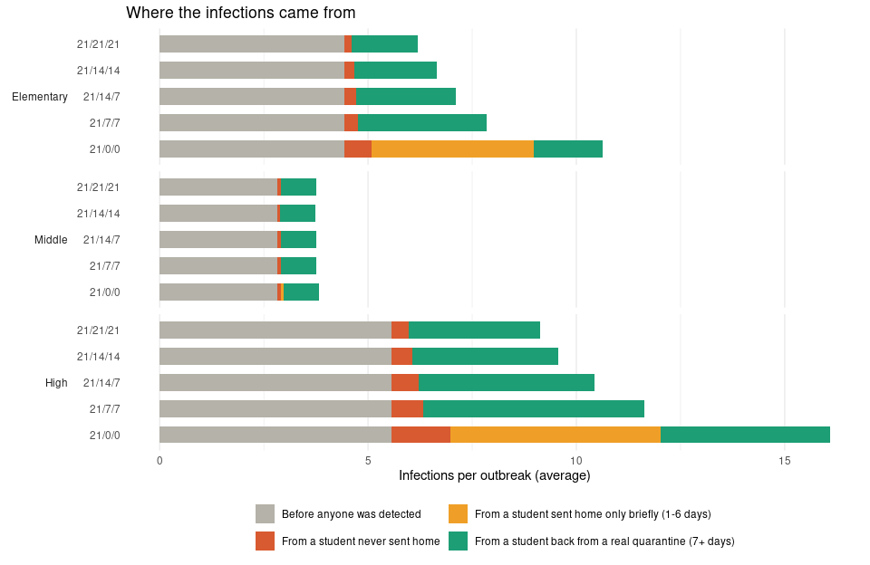

### Why do the strategies differ?

Change in infections per outbreak compared with 21/21/21 **on the same
outbreaks**, split by where the infections came from. This shows **which
group** makes one strategy end with more or fewer cases than another.

| School     | Strategy | Before anyone was detected | From a student never sent home | From a student sent home only briefly (1-6 days) | From a student back from a real quarantine (7+ days) | Total |
|:-----------|:---------|---------------------------:|-------------------------------:|-------------------------------------------------:|-----------------------------------------------------:|------:|
| Elementary | 21/14/14 |                      +0.00 |                          +0.06 |                                            +0.00 |                                                +0.40 | +0.46 |
| Elementary | 21/14/7  |                      +0.00 |                          +0.11 |                                            +0.00 |                                                +0.82 | +0.93 |
| Elementary | 21/7/7   |                      +0.00 |                          +0.16 |                                            +0.00 |                                                +1.50 | +1.66 |
| Elementary | 21/0/0   |                      +0.00 |                          +0.48 |                                            +3.91 |                                                +0.07 | +4.45 |
| Middle     | 21/14/14 |                      +0.00 |                          -0.00 |                                            +0.00 |                                                -0.00 | -0.00 |
| Middle     | 21/14/7  |                      +0.00 |                          +0.00 |                                            +0.00 |                                                +0.01 | +0.01 |
| Middle     | 21/7/7   |                      +0.00 |                          +0.00 |                                            +0.00 |                                                +0.01 | +0.01 |
| Middle     | 21/0/0   |                      +0.00 |                          +0.01 |                                            +0.06 |                                                -0.01 | +0.07 |
| High       | 21/14/14 |                      +0.00 |                          +0.09 |                                            +0.00 |                                                +0.34 | +0.43 |
| High       | 21/14/7  |                      +0.00 |                          +0.25 |                                            +0.00 |                                                +1.06 | +1.31 |
| High       | 21/7/7   |                      +0.00 |                          +0.35 |                                            +0.00 |                                                +2.15 | +2.50 |
| High       | 21/0/0   |                      +0.00 |                          +1.00 |                                            +5.04 |                                                +0.92 | +6.96 |

Extra (+) or fewer () infections per outbreak than 21/21/21, by where
they came from.

**How to read it, and what each column means for the reason behind a
difference:**

- **Before anyone was detected** should be **0** for every strategy:
  fair pairs are identical until the first detection. Any difference
  here would point to a problem.
- **From a student never sent home**: infections by vaccinated students
  whose vaccine failed. No strategy can reach them, because vaccinated
  students are never quarantined. Differences here are indirect: a
  strategy that lets the outbreak grow exposes more vaccinated students,
  so more of them are infected and pass it on.
- **From a student sent home only briefly**: the main effect of short
  medium/low-risk quarantine. A 0-day quarantine keeps a student home
  for **one day**, but a student is contagious for about four days on
  average and the latent period is long, so a one-day stay rarely covers
  the contagious days. These students come back and infect others.
  Longer medium/low-risk quarantine (7 or 14 days) moves these students
  into the “real quarantine” groups or keeps their contagious days at
  home.
- **From a student back from a real quarantine**: infections by students
  released after 7+ days while still infected. This can be **larger**
  under stricter strategies, because more infected students are
  quarantined and released together (and the model’s latent period has a
  long tail, so some are still latent after 21 days; see document 6). It
  shows the cost side of quarantining more students.
- **Total** equals the difference in mean cases in Table B.

### What happened to each infected student?

| School     | Strategy | Contagious period fully at home | Back from a real quarantine (7+ days) still infected | Home only 1-6 days while infected, contagious at school | Never sent home while infected | Still latent on the last day | Others infected by each: back from a real quarantine (7+ days) still infected | Others infected by each: home only 1-6 days while infected, contagious at school | Others infected by each: never sent home while infected |
|:-----------|:---------|--------------------------------:|-----------------------------------------------------:|--------------------------------------------------------:|-------------------------------:|-----------------------------:|------------------------------------------------------------------------------:|---------------------------------------------------------------------------------:|--------------------------------------------------------:|
| Elementary | 21/21/21 |                             57% |                                                  13% |                                                      6% |                            22% |                           3% |                                                                           1.7 |                                                                              1.3 |                                                     1.2 |
| Elementary | 21/14/14 |                             53% |                                                  16% |                                                      6% |                            22% |                           3% |                                                                           1.6 |                                                                              1.4 |                                                     1.2 |
| Elementary | 21/14/7  |                             50% |                                                  19% |                                                      6% |                            21% |                           4% |                                                                           1.5 |                                                                              1.3 |                                                     1.2 |
| Elementary | 21/7/7   |                             48% |                                                  21% |                                                      6% |                            21% |                           4% |                                                                           1.6 |                                                                              1.3 |                                                     1.2 |
| Elementary | 21/0/0   |                             40% |                                                   9% |                                                     26% |                            19% |                           5% |                                                                           1.3 |                                                                              1.5 |                                                     1.2 |
| Middle     | 21/21/21 |                             53% |                                                  13% |                                                      7% |                            25% |                           2% |                                                                           1.4 |                                                                              1.0 |                                                     1.0 |
| Middle     | 21/14/14 |                             53% |                                                  13% |                                                      7% |                            25% |                           2% |                                                                           1.4 |                                                                              1.0 |                                                     1.0 |
| Middle     | 21/14/7  |                             53% |                                                  13% |                                                      7% |                            25% |                           3% |                                                                           1.4 |                                                                              1.0 |                                                     1.0 |
| Middle     | 21/7/7   |                             52% |                                                  13% |                                                      7% |                            25% |                           3% |                                                                           1.4 |                                                                              1.0 |                                                     1.0 |
| Middle     | 21/0/0   |                             52% |                                                  13% |                                                      8% |                            25% |                           3% |                                                                           1.4 |                                                                              1.0 |                                                     1.0 |
| High       | 21/21/21 |                             58% |                                                  11% |                                                      6% |                            20% |                           5% |                                                                           2.2 |                                                                              1.8 |                                                     1.5 |
| High       | 21/14/14 |                             55% |                                                  14% |                                                      6% |                            20% |                           5% |                                                                           1.9 |                                                                              1.8 |                                                     1.5 |
| High       | 21/14/7  |                             51% |                                                  18% |                                                      5% |                            19% |                           6% |                                                                           1.7 |                                                                              1.7 |                                                     1.5 |
| High       | 21/7/7   |                             49% |                                                  21% |                                                      5% |                            19% |                           6% |                                                                           1.7 |                                                                              1.7 |                                                     1.5 |
| High       | 21/0/0   |                             42% |                                                   8% |                                                     26% |                            17% |                           7% |                                                                           1.7 |                                                                              1.6 |                                                     1.5 |

Table 2. What happened to each infected student (first case excluded),
and how many others they infected on average.

- *Contagious period fully at home*: the student was at home
  (quarantine) for all their contagious days, so quarantine fully worked
  for them.
- *Back from a real quarantine still infected*: home 7+ days in a row
  while infected, but contagious at school after returning.
- *Home only 1-6 days while infected, contagious at school*: at home
  only briefly while infected, and contagious at school for at least one
  day. This is mainly the 1-day stays of a 0-day quarantine, plus
  students who were sent home partway through their contagious period
  (they had already been contagious at school; this is why the group is
  not empty under 21/21/21).
- *Never sent home while infected*: at school for the whole infection.
- *Still latent on the last day*: infected near the end of the
  simulation, not yet contagious.

### Why does an infection happen under one strategy but not the other?

Take every infection “student X infects student Y on day d” where Y is
infected on day d under one strategy but **not** under the other, on the
same outbreak. Since the dice are the same, there must be a concrete
reason. Looking at the other strategy on the start of day d, the reasons
are checked in this order:

1.  **X was infected on a different day there (or not at all).** X’s own
    infection already differed, so X is contagious on different days (or
    never).
2.  **X was at home that day** (in quarantine while contagious).
3.  **Y was already infected** there (by someone else, earlier).
4.  **Y was at home that day** (in quarantine).
5.  **Both at school, but a different chance of meeting.** X was
    contagious and Y was healthy at school under both strategies, but a
    different number of X’s classmates were at school, so the chance
    that they meet was different (see the table at the top).
6.  **Other**: none of the above. This should be **0%**: if X was
    contagious and Y healthy, both at school with the same chance of
    meeting, the same dice give the same result. It is a check that the
    comparison is fair.

| School     | Other strategy | Per outbreak | X infected on a different day (or not at all) | X at home that day | Y already infected | Y at home that day | Both at school, different chance of meeting | Other |
|:-----------|:---------------|-------------:|----------------------------------------------:|-------------------:|-------------------:|-------------------:|--------------------------------------------:|------:|
| Elementary | 21/14/14       |         0.49 |                                           33% |                42% |                 8% |                16% |                                          0% |    0% |
| Elementary | 21/14/7        |         0.37 |                                           37% |                36% |                11% |                16% |                                          0% |    0% |
| Elementary | 21/7/7         |         0.47 |                                           32% |                46% |                 7% |                15% |                                          0% |    0% |
| Elementary | 21/0/0         |         0.43 |                                           34% |                29% |                25% |                12% |                                          0% |    0% |
| Middle     | 21/14/14       |         0.03 |                                           40% |                10% |                 0% |                50% |                                          0% |    0% |
| Middle     | 21/14/7        |         0.00 |                                            \- |                 \- |                 \- |                 \- |                                          \- |    \- |
| Middle     | 21/7/7         |         0.00 |                                            \- |                 \- |                 \- |                 \- |                                          \- |    \- |
| Middle     | 21/0/0         |         0.00 |                                            \- |                 \- |                 \- |                 \- |                                          \- |    \- |
| High       | 21/14/14       |         1.69 |                                           42% |                43% |                 3% |                11% |                                          0% |    0% |
| High       | 21/14/7        |         1.36 |                                           41% |                37% |                 6% |                16% |                                          0% |    0% |
| High       | 21/7/7         |         1.56 |                                           40% |                42% |                 6% |                12% |                                          0% |    0% |
| High       | 21/0/0         |         1.70 |                                           41% |                39% |                 9% |                12% |                                          0% |    0% |

Infections that happen under 21/21/21 but NOT under the other strategy
(same outbreak): how many per outbreak, and why they did not happen
under the other strategy (300 fair pairs).

| School     | Other strategy | Per outbreak | X infected on a different day (or not at all) | X at home that day | Y already infected | Y at home that day | Both at school, different chance of meeting | Other |
|:-----------|:---------------|-------------:|----------------------------------------------:|-------------------:|-------------------:|-------------------:|--------------------------------------------:|------:|
| Elementary | 21/14/14       |         0.85 |                                           42% |                49% |                 0% |                 8% |                                          0% |    0% |
| Elementary | 21/14/7        |         1.20 |                                           45% |                47% |                 1% |                 7% |                                          0% |    0% |
| Elementary | 21/7/7         |         2.23 |                                           53% |                42% |                 0% |                 5% |                                          0% |    0% |
| Elementary | 21/0/0         |         4.57 |                                           58% |                38% |                 0% |                 5% |                                          0% |    0% |
| Middle     | 21/14/14       |         0.00 |                                            0% |               100% |                 0% |                 0% |                                          0% |    0% |
| Middle     | 21/14/7        |         0.01 |                                           67% |                33% |                 0% |                 0% |                                          0% |    0% |
| Middle     | 21/7/7         |         0.01 |                                           50% |                50% |                 0% |                 0% |                                          0% |    0% |
| Middle     | 21/0/0         |         0.06 |                                           22% |                78% |                 0% |                 0% |                                          0% |    0% |
| High       | 21/14/14       |         2.11 |                                           48% |                45% |                 1% |                 5% |                                          0% |    0% |
| High       | 21/14/7        |         2.88 |                                           53% |                38% |                 1% |                 7% |                                          0% |    0% |
| High       | 21/7/7         |         4.04 |                                           55% |                39% |                 1% |                 6% |                                          0% |    0% |
| High       | 21/0/0         |         9.22 |                                           62% |                33% |                 0% |                 5% |                                          0% |    0% |

Infections that happen under the other strategy but NOT under 21/21/21:
how many per outbreak, and why they did not happen under 21/21/21.

**How to read these two tables.** *Per outbreak* is how many infections,
on average, happen under one strategy only. Comparing the two tables
gives the net effect: for 21/0/0, many more infections happen only under
21/0/0 than only under 21/21/21. The reason columns explain each one.
Most differences are chains: once one infection differs (reason 1),
everything that follows it differs too. Reasons 2 and 4 are the direct
effect of quarantine: someone was at home on that day under one strategy
and not the other. Reason 5 is a side effect of the model’s contact
rule: when many students are at home, those left at school meet each
other more often; it is rare.

**So why does stricter quarantine sometimes give more infections?** Not
because of chance: the dice are the same. It is because quarantine
changes *when* students are at home, and the outbreaks then follow
different paths:

- a student sent home for 21 days while still latent can come back and
  become contagious at school later (the long latent tail of the model),
  on days when under the shorter strategy they were at home for a
  different reason, or not infected at all;
- once one infection differs, the cases that follow it, the days they
  are detected, and therefore who is sent home and when, all differ
  (reason 1).

## Grade-to-grade spread (21/21/21 vs 21/0/0)

Each circle is a grade; arrow width = average number of infections per
outbreak from one grade into another. The number inside each circle is
the average number of infections inside that grade.

| School     | Strategy | Outbreaks that stayed in one grade | Jumps per outbreak | Before anyone was detected | From a student never sent home | From a student sent home only briefly (1-6 days) | From a student back from a real quarantine (7+ days) |
|:-----------|:---------|-----------------------------------:|-------------------:|---------------------------:|-------------------------------:|-------------------------------------------------:|-----------------------------------------------------:|
| Elementary | 21/21/21 |                                27% |               2.30 |                        70% |                             3% |                                               0% |                                                  26% |
| Elementary | 21/14/14 |                                27% |               2.44 |                        66% |                             4% |                                               0% |                                                  29% |
| Elementary | 21/14/7  |                                27% |               2.60 |                        62% |                             5% |                                               0% |                                                  33% |
| Elementary | 21/7/7   |                                27% |               2.82 |                        57% |                             6% |                                               0% |                                                  37% |
| Elementary | 21/0/0   |                                26% |               3.67 |                        44% |                             9% |                                              30% |                                                  16% |
| Middle     | 21/21/21 |                                95% |               0.04 |                        75% |                             0% |                                               0% |                                                  25% |
| Middle     | 21/14/14 |                                96% |               0.03 |                        84% |                             0% |                                               0% |                                                  16% |
| Middle     | 21/14/7  |                                95% |               0.04 |                        75% |                             0% |                                               0% |                                                  25% |
| Middle     | 21/7/7   |                                95% |               0.04 |                        75% |                             0% |                                               0% |                                                  25% |
| Middle     | 21/0/0   |                                95% |               0.04 |                        73% |                             3% |                                               0% |                                                  24% |
| High       | 21/21/21 |                                12% |               4.66 |                        60% |                             4% |                                               0% |                                                  35% |
| High       | 21/14/14 |                                12% |               4.67 |                        60% |                             6% |                                               0% |                                                  34% |
| High       | 21/14/7  |                                12% |               5.12 |                        55% |                             7% |                                               0% |                                                  38% |
| High       | 21/7/7   |                                12% |               5.57 |                        50% |                             7% |                                               0% |                                                  42% |
| High       | 21/0/0   |                                12% |               7.25 |                        39% |                            11% |                                              26% |                                                  24% |

Table 3. Infections that jump into another grade, and where the infector
had been (all strategies).

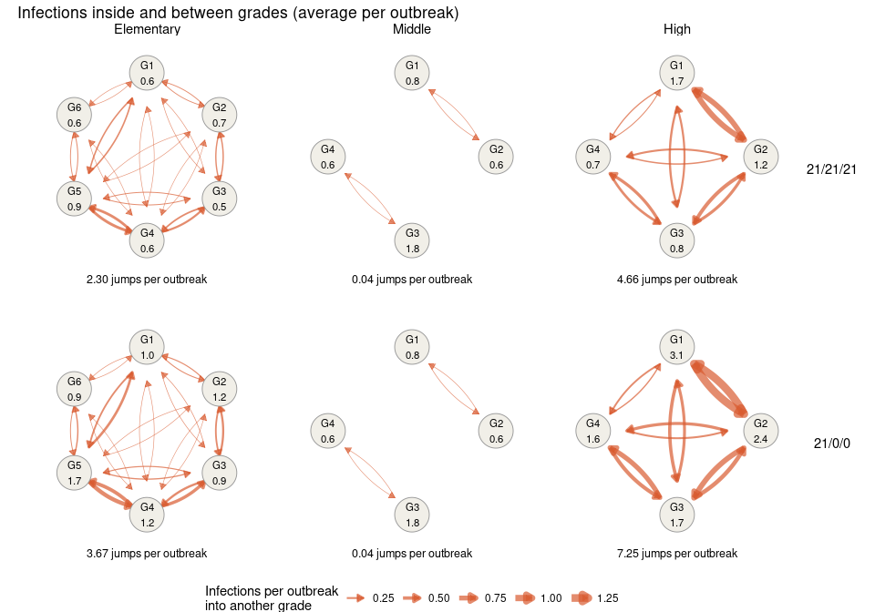

## One fair example per school

For each school, one outbreak where 21/21/21 ended with **more** cases
than 21/0/0, and one where it ended with **fewer** (the largest such
difference among outbreaks with at most 60 cases). Everything is
identical in the two runs except who is at home, so every difference is
caused by the strategy. Each dot is an infected student (left to right =
day infected, rows = grade); filled dots were infected under both
strategies, open dots under this strategy only. Arrows are coloured by
where the infector had been.

The first two figures show only **who infected whom, and on which day**.
The third figure adds **what state every infected student is in on every
day, and when they are at home**:

- one row per student infected under either strategy; the same student
  is on the same row in both panels;
- the coloured bar is the disease state: grey = latent, red = contagious
  (the only state that infects), light purple = rash at school, purple =
  isolated or in hospital; no bar = healthy or recovered;
- the tan background marks days at home in quarantine, including days at
  home while still healthy;
- a dotted row means this student was never infected under that
  strategy;
- arrows run from the infector’s row to the new case’s row on the day of
  infection, coloured as above. An arrow always starts from a red
  (contagious) bar on a day without tan background, because only
  contagious students at school infect.

### Elementary

**Example: 21/21/21 ended with MORE cases than 21/0/0** (this happened
in 3% of the 2000 fair pairs)

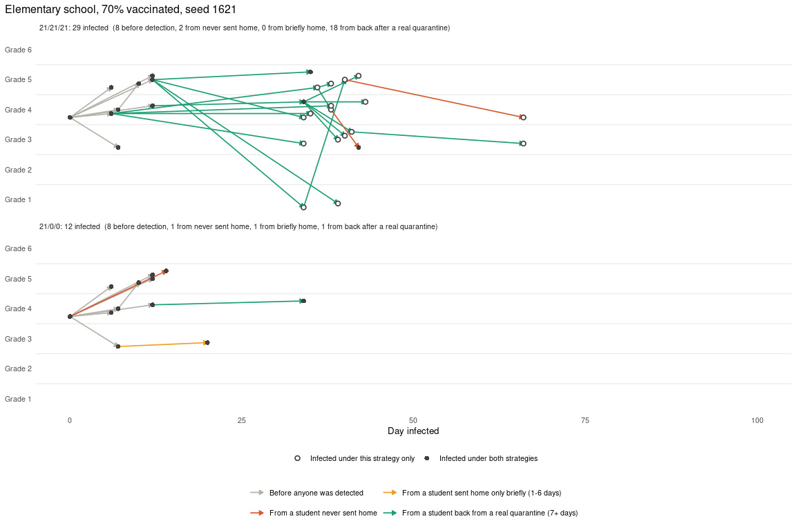

*Day by day: which state each infected student is in, and when they are
at home.*

**Example: 21/21/21 ended with FEWER cases than 21/0/0** (this happened
in 45% of the 2000 fair pairs)

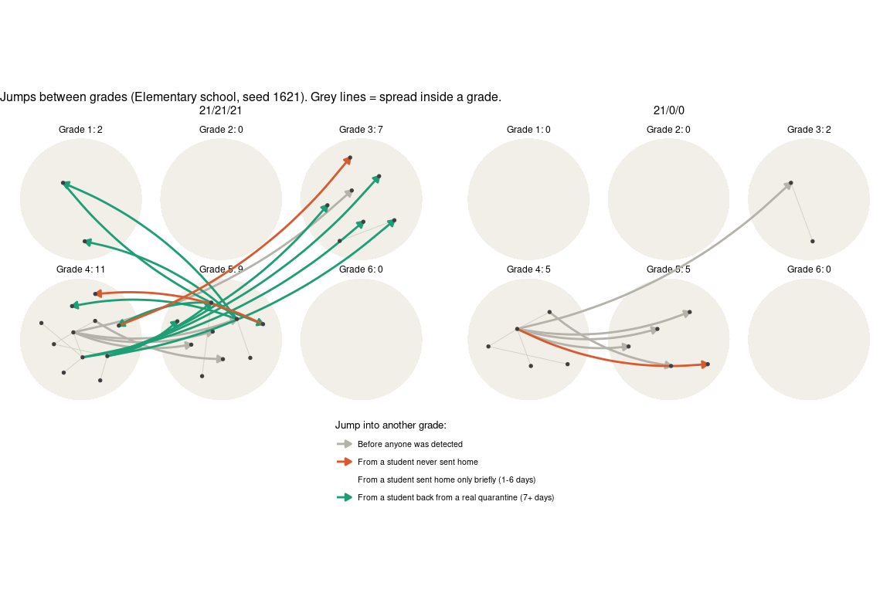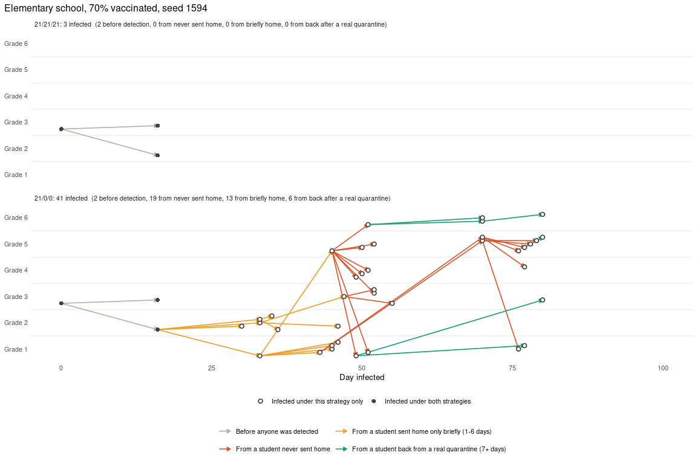

*Day by day: which state each infected student is in, and when they are
at home.*

### Middle

No outbreak where 21/21/21 ended with MORE cases than 21/0/0.

**Example: 21/21/21 ended with FEWER cases than 21/0/0** (this happened
in 2% of the 2000 fair pairs)

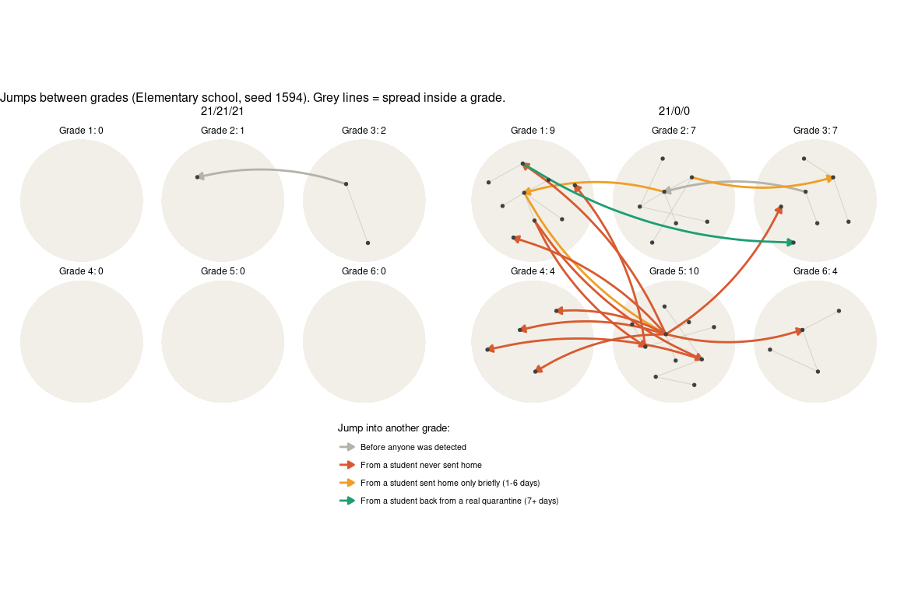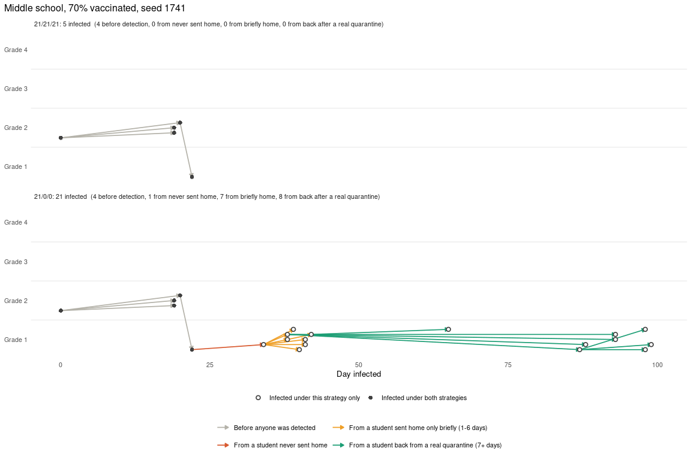

*Day by day: which state each infected student is in, and when they are
at home.*

### High

**Example: 21/21/21 ended with MORE cases than 21/0/0** (this happened
in 5% of the 2000 fair pairs)

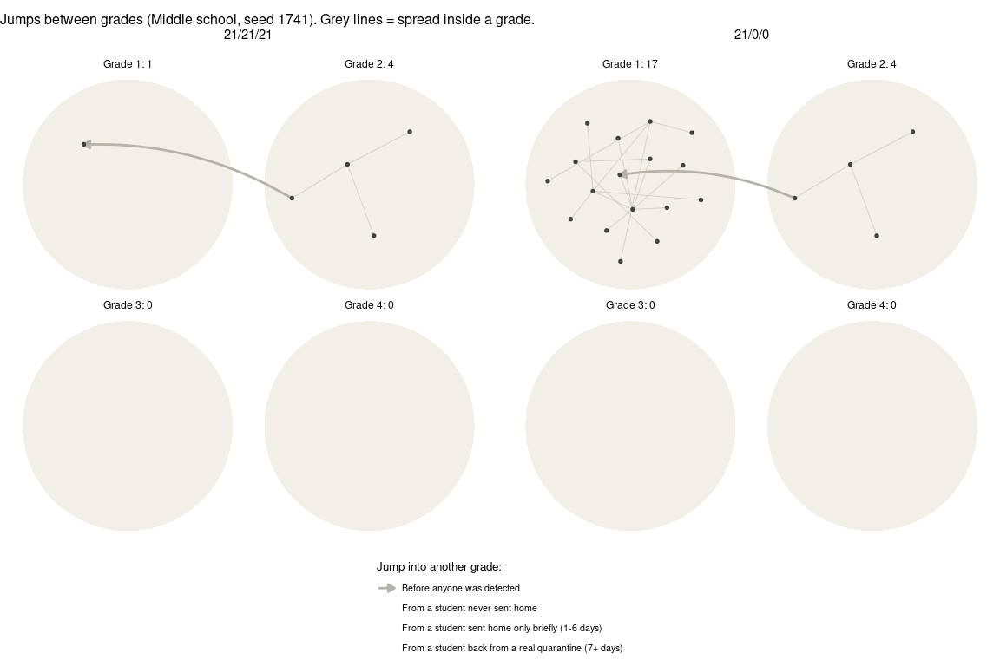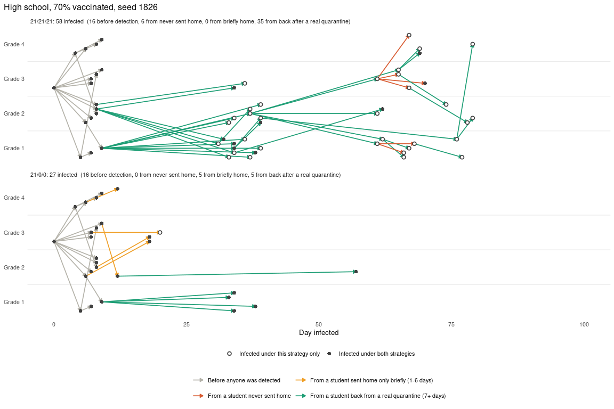

*Day by day: which state each infected student is in, and when they are
at home.*

**Example: 21/21/21 ended with FEWER cases than 21/0/0** (this happened
in 59% of the 2000 fair pairs)

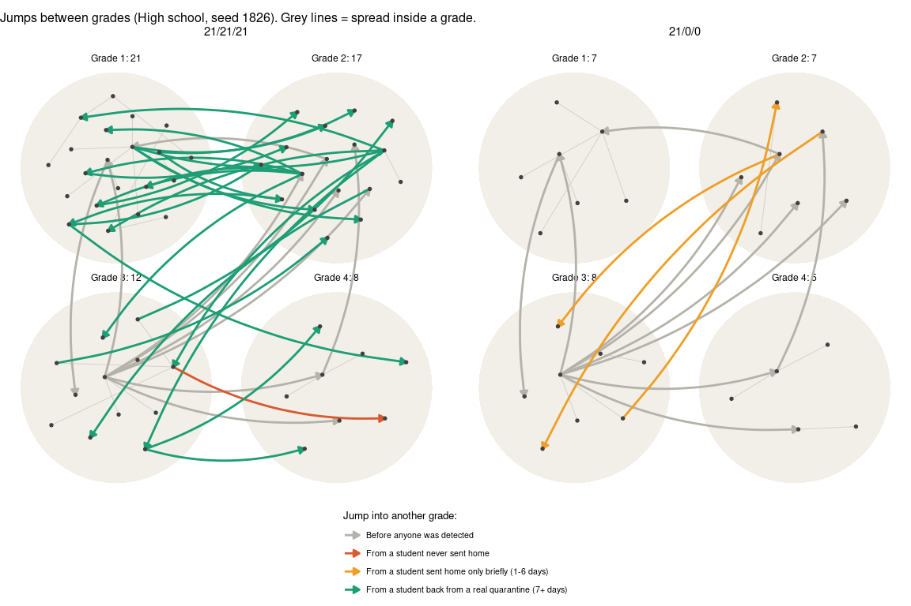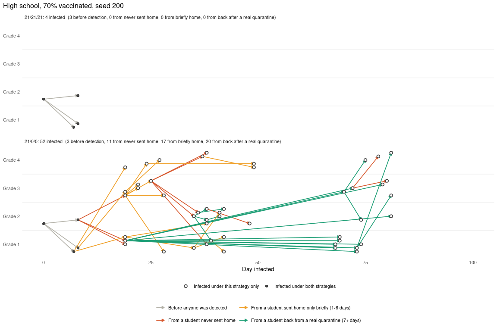

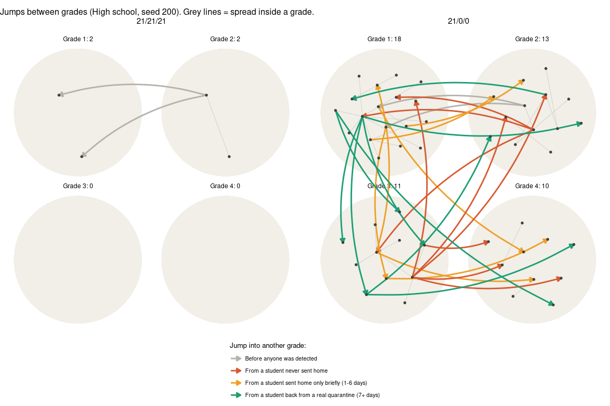

*Day by day: which state each infected student is in, and when they are
at home.*

## Notes

- Outbreak size = number of students infected by day 100, including the
  first case (one row per infection in the transmission record).
- The model’s disease rules are unchanged; only the way random numbers
  are used is changed (common random numbers). Averages agree with the
  normal package within simulation error, but individual runs differ
  from it.
- Intervals reflect simulation (Monte Carlo) uncertainty only, not
  uncertainty in the model’s assumptions (see document 6 for how the
  model’s disease timing compares with real measles).
